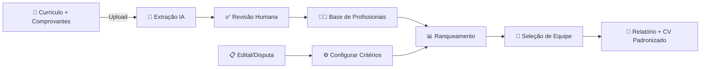
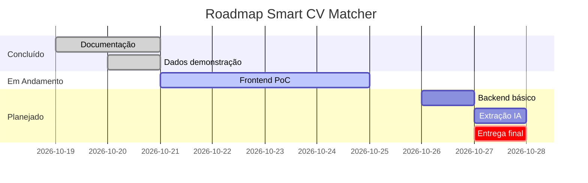

# Smart CV Matcher

> Sistema inteligente de matching de currículos para propostas comerciais com IA explicável

**Case EloGroup — HackatOhm 2026 | CEFET-MG**

[](docs/13-desenvolvimento-da-poc.md)
[](docs/README.md)
[](docs/15-frontend-spec.md)

---

## O Problema

Empresas de consultoria enfrentam um desafio recorrente: montar equipes qualificadas para propostas comerciais em tempo hábil, garantindo que cada profissional atenda aos critérios específicos do edital e possua as evidências documentais necessárias.

O processo manual é:
- **Lento**: revisar dezenas de currículos manualmente
- **Propenso a erros**: perder prazos de validade de certificações
- **Inauditável**: difícil justificar a escolha após a submissão
- **Desatualizado**: currículos rapidamente ficam defasados

---

## A Solução

O **Smart CV Matcher** transforma currículos e comprovantes em uma base estruturada e sempre atualizada, permitindo:

### Core Features

| Feature | Descrição |
|---------|-----------|
| **Extração Inteligente** | IA extrai formações, certificações e experiências de documentos |
| **Pontuação Explicável** | Cada ponto vinculado a regra, evidência e fonte |
| **Matching Automatizado** | Ranqueamento por aderência aos critérios do edital |
| **Gestão de Evidências** | Status claro: comprovado, pendente, vencido ou ausente |
| **Composição de Equipes** | Seleção assistida respeitando vagas, papéis e disponibilidade |
| **Base Viva** | Atualização contínua com responsáveis por pendências |

### Diferenciais

```
┌─────────────────────────────────────────────────────────────┐
│  PONTUAÇÃO EXPLICÁVEL                                       │
│  ┌─────────────────────────────────────────────────────┐    │
│  │ Critério: PMP (10 pts)                              │    │
│  │ Status: ✅ Comprovado                                │    │
│  │ Evidência: Certificado PMI #123456                   │    │
│  │ Validade: até 31/12/2027                             │    │
│  │ Regra: Binário, válido na data de corte              │    │
│  └─────────────────────────────────────────────────────┘    │
└─────────────────────────────────────────────────────────────┘
```

---

## Jornada do Usuário



### 1. Base de Profissionais
Consulte o acervo, filtre por qualificações e acesse perfis com histórico completo, evidências e pendências.

### 2. Configuração de Disputa
Defina título, função, vagas, data de corte e critérios de pontuação com pesos e tetos configuráveis.

### 3. Ranking Explicável
Visualize pontuação comprovada e pendente de cada profissional, com detalhamento por critério.

### 4. Composição de Equipe
Selecione profissionais elegíveis respeitando vagas, disponibilidade e restrições.

### 5. Relatório e Exportação
Gere currículo padronizado e relatório auditável com pontuação e evidências.

---

## Arquitetura

### Fase 1: PoC Frontend-First

```
┌────────────────────────────────────────────────────────┐
│                  INTERFACE WEB (React)                 │
│  ┌─────────────┬──────────────┬──────────────────┐     │
│  │   Páginas   │  Componentes │   Motor Regras   │     │
│  └─────────────┴──────────────┴──────────────────┘     │
├────────────────────────────────────────────────────────┤
│                 ADAPTADOR DE DADOS                     │
│         (JSON sintético → Estado React)                │
├────────────────────────────────────────────────────────┤
│              DADOS DE DEMONSTRAÇÃO                     │
│   12 perfis fictícios + critérios + evidências        │
└────────────────────────────────────────────────────────┘

✅ Zero dependência de backend
✅ Cálculo determinístico no browser
✅ Dados de demonstração realistas
```

### Fase 2: Evolução com Backend

```
┌──────────────┐      ┌──────────────┐      ┌─────────────┐
│   Frontend   │─────▶│   API REST   │─────▶│  PostgreSQL │
│    React     │      │   Node.js    │      │   (Dados)   │
└──────────────┘      └──────┬───────┘      └─────────────┘
                             │
                      ┌──────▼───────┐      ┌─────────────┐
                      │ Processador  │─────▶│  IA (LLM)   │
                      │  Documental  │      │  Extração   │
                      └──────────────┘      └─────────────┘
```

---

## Stack Tecnológica

### Frontend (PoC Atual)

| Tecnologia | Uso |
|------------|-----|
| **React 18** | Framework UI |
| **TypeScript** | Type safety |
| **Tailwind CSS** | Estilização utilitária |
| **React Router** | Navegação SPA |
| **Zustand** | Gerenciamento de estado |
| **Vite** | Build e dev server |

### Backend (Futuro)

| Tecnologia | Uso |
|------------|-----|
| **Node.js + Express** | API REST |
| **PostgreSQL** | Persistência relacional |
| **OpenAI API** | Extração documental |
| **MinIO/S3** | Armazenamento de arquivos |

---

## Estrutura do Projeto

```
smart-cv-matcher/
├── docs/                          # Documentação completa
│   ├── 01-evento-e-regulamento.md
│   ├── 02-case-e-diagnostico.md
│   ├── 03-proposta-da-solucao.md
│   ├── 04-requisitos-e-jornadas.md
│   ├── 05-extracao-e-ia.md
│   ├── 06-pontuacao-e-equipes.md
│   ├── 07-arquitetura-e-dados.md
│   ├── 08-seguranca-e-governanca.md
│   ├── 09-impacto-e-validacao.md
│   ├── 10-plano-de-execucao.md
│   ├── 11-resumo-e-pitch.md
│   ├── 12-fontes-e-decisoes.md
│   ├── 13-desenvolvimento-da-poc.md
│   ├── 14-backlog-e-colaboracao.md
│   ├── 15-frontend-spec.md        # ⭐ Especificação Frontend
│   ├── exemplos/                  # Dados de demonstração
│   │   ├── perfis-demonstracao.json
│   │   ├── criterios-demonstracao.json
│   │   └── resultados-esperados.json
│   └── fontes/
│       ├── case-hackathon.html
│       └── regulamento-texto.txt
├── src/                           # Código fonte (futuro)
│   ├── pages/
│   ├── components/
│   ├── domain/
│   ├── services/
│   └── data/
└── README.md
```

---

## Dados de Demonstração

O projeto inclui **12 perfis profissionais fictícios** com cenários variados:

| Perfil | PMP | Pós | Projetos Energia | Experiência | Disponível | Situação |
|--------|-----|-----|------------------|-------------|------------|----------|
| **Ana** | ✅ | ✅ | 4 projetos | 16 anos | ✅ | Score máximo (28 pts) |
| **Carla** | ⏳ Pendente | ✅ | 4 projetos | 15 anos | ✅ | 18 comprovados + 10 pendentes |
| **Diego** | ✅ | ✅ | 4 projetos | 17 anos | ❌ | Inelegível (indisponível) |
| **Fabio** | ⚠️ Vencido | ✅ | 2 projetos | 13 anos | ✅ | PMP não pontua |
| **Gabriela** | ❌ | ✅ | 0 projetos | 6 anos | ✅ | Não atende mínimo |

> Ver todos os perfis em [`docs/exemplos/perfis-demonstracao.json`](docs/exemplos/perfis-demonstracao.json)

---

## Documentação

### 📚 Principais Documentos

- **[Proposta da Solução](docs/03-proposta-da-solucao.md)** — Visão, diferenciais e escopo
- **[Requisitos e Jornadas](docs/04-requisitos-e-jornadas.md)** — RF/RNF e critérios de aceite
- **[Arquitetura e Dados](docs/07-arquitetura-e-dados.md)** — Modelo de entidades e APIs
- **[Especificação do Frontend](docs/15-frontend-spec.md)** — Páginas, componentes e design system
- **[Desenvolvimento da PoC](docs/13-desenvolvimento-da-poc.md)** — Roteiro de implementação
- **[Backlog](docs/14-backlog-e-colaboracao.md)** — Tarefas e divisão de trabalho

### 🎨 Design e Interface

- **[System Design](docs/15-frontend-spec.md#system-design)** — Princípios e padrões visuais
- **[Páginas](docs/15-frontend-spec.md#páginas)** — Wireframes e especificações
- **[Componentes](docs/15-frontend-spec.md#componentes)** — Biblioteca de UI
- **[Estados](docs/15-frontend-spec.md#estados)** — Comprovado, pendente, vencido, ausente

---

## Começando

### Pré-requisitos

```bash
# Verificar Node.js (18+)
node --version  # v18.x.x ou superior

# Verificar npm
npm --version   # 9.x.x ou superior
```

### Instalação

```bash
# Clonar repositório
git clone <url-do-repositorio>
cd smart-cv-matcher

# Instalar dependências (quando houver código)
npm install

# Executar em desenvolvimento
npm run dev
```

> **Nota**: A aplicação ainda não foi implementada. Os comandos acima são para quando o código estiver pronto.

---

## Status do Projeto

**Fase Atual:** Documentação e planejamento completos



### Checkpoint

- [x] Documentação completa de requisitos
- [x] Casos de demonstração e dados fictícios
- [x] Especificação de arquitetura
- [x] Especificação de frontend
- [ ] Interface de listagem e perfil
- [ ] Formulário de critérios
- [ ] Cálculo de pontuação no frontend
- [ ] Explicação detalhada por critério
- [ ] Seleção de equipe
- [ ] Relatório e exportação
- [ ] Backend com API REST (opcional)
- [ ] Extração real com IA (opcional)

---

## Contribuindo

Este é um projeto acadêmico para o **HackatOhm 2026**. Contribuições dos integrantes da equipe:

1. Conferir tarefas no [backlog](docs/14-backlog-e-colaboracao.md)
2. Criar branch: `git checkout -b feature/nome-da-feature`
3. Seguir a [especificação frontend](docs/15-frontend-spec.md)
4. Testar com os [dados de exemplo](docs/exemplos/)
5. Submeter para revisão do grupo

### Padrões de Código

- **TypeScript strict mode** obrigatório
- **ESLint + Prettier** para formatação
- **Conventional Commits** para mensagens
- **Testes** para funções de cálculo

---

## Licença

Projeto acadêmico desenvolvido para o **HackatOhm 2026 — CEFET-MG**.

---

## Equipe

**Case EloGroup** — HackatOhm 2026

- Alexsander Lima
- [Outros integrantes]

---

## Avisos

⚠️ **Dados Sintéticos**: Este projeto utiliza dados inteiramente fictícios para demonstração. Nenhum dado real de profissionais ou organizações é processado.

⚠️ **Status de Desenvolvimento**: A aplicação está em fase de PoC. Não utilizar em produção.

⚠️ **IA Explicável**: O sistema prioriza rastreabilidade e transparência. Cada decisão é justificada com evidências.

---

**[📖 Ver Documentação Completa](docs/README.md)** | **[🎨 Ver Especificação Frontend](docs/15-frontend-spec.md)**
