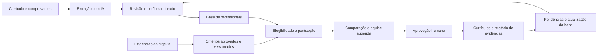

# 03 — Proposta da solução

## Visão

O **Smart CV Matcher** transforma currículos e comprovantes em uma base consultável e recomenda profissionais e equipes para cada disputa comercial. IA auxilia a leitura e a organização; regras aprovadas pelo gestor calculam os pontos; pessoas validam fatos, documentos e escolhas finais.

O ponto de partida da equipe — extrair currículos com IA, montar uma base e pontuar critérios selecionados — é mantido. A proposta acrescenta quatro capacidades essenciais ao case: comprovação por critério, composição de equipe com restrições, padronização do currículo e atualização contínua do acervo.

## Fluxo de valor

## Diferenciais propostos

- **Pontuação explicável:** detalhamento de regra, valor observado, fonte, comprovação e pontos.
- **Visão de lacunas:** separar pontos comprovados de pontos que dependem de revisão ou documento.
- **Escolha da combinação:** considerar papéis, quantidade de vagas e disponibilidade, além do ranking individual.
- **Currículo fiel à disputa:** reorganizar fatos aprovados em um modelo, preservando datas, atribuições e qualificações.
- **Base viva:** registrar novos projetos e vencimentos no fluxo de trabalho, com responsável por cada pendência.

Esses diferenciais são decisões propostas de produto, ainda sem validação de uso ou implementação.

## Escopo inicial da PoC

A prioridade do grupo é demonstrar primeiro o percurso no front, com os 12 perfis sintéticos já estruturados: consultar a base; definir critérios; calcular pontos no navegador; explicar o ranking; selecionar uma pessoa elegível; gerar um relatório simples. Iniciar com uma função e uma vaga. A experiência de importação e revisão pode ser simulada e deve ser identificada dessa forma.

A PoC inicial funciona sem servidor, banco de dados ou provedor de IA. O cálculo no navegador deve aplicar as regras de verdade; a extração documental é que fica simulada. Se houver tempo após estabilizar a jornada, substituir o acesso ao JSON por um back pequeno. Extração real por IA e composição de múltiplos papéis são extensões posteriores.

| Essencial para a PoC de front | Evolução depois da primeira PoC |
|---|---|
| Base sintética local, lista e perfil | API e persistência básica |
| Estado explícito das evidências fictícias | Upload e extração real por IA |
| Critérios editáveis em formulário | Extração de critérios do edital com revisão |
| Pontuação determinística no navegador | Motor de regras no servidor |
| Comparação e seleção de uma vaga | Composição de equipe com múltiplos papéis |
| Relatório simples e prévia padronizada | Exportação avançada e integrações |

As etapas e os critérios de conclusão estão no [roteiro de desenvolvimento](13-desenvolvimento-da-poc.md). Os demais capítulos descrevem capacidades desejáveis do produto, incluindo partes que ficam fora da primeira demonstração.

Não prometer verificação automática de autenticidade, sucesso em licitação ou decisão autônoma sobre pessoas.

## Operação da base

1. Na entrada, o profissional revisa os campos extraídos; o responsável pelo acervo trata duplicidades.
2. Após um projeto, o profissional registra setor, atividades, período e documento disponível; o revisor valida a aderência.
3. Antes de cada disputa, o gestor confirma disponibilidade e a validade dos documentos na data de corte.
4. Em ciclos definidos pela organização, o sistema pede confirmação de atualização. Proposta inicial: lembrete após 90 dias sem revisão, sujeito a validação.
5. Vencimentos geram avisos com antecedência configurável. A ausência de resposta mantém a pendência visível e não renova certificados.

Mostrar data de última confirmação, responsável e completude. Atualização é um processo com dono; lembretes sozinhos não garantem adesão.

## Posicionamento

O produto apoia a montagem da equipe-chave de uma proposta comercial. A pontuação expressa aderência a regras daquela disputa e não o valor geral do profissional. Um candidato com pontuação baixa em um edital pode ser o mais indicado em outro.
