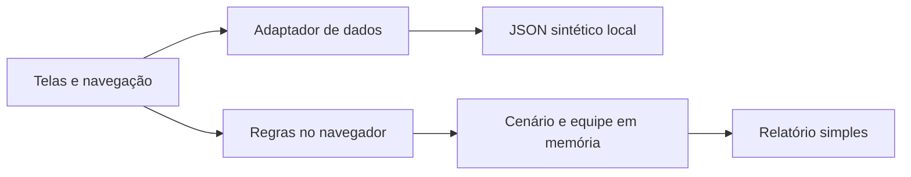
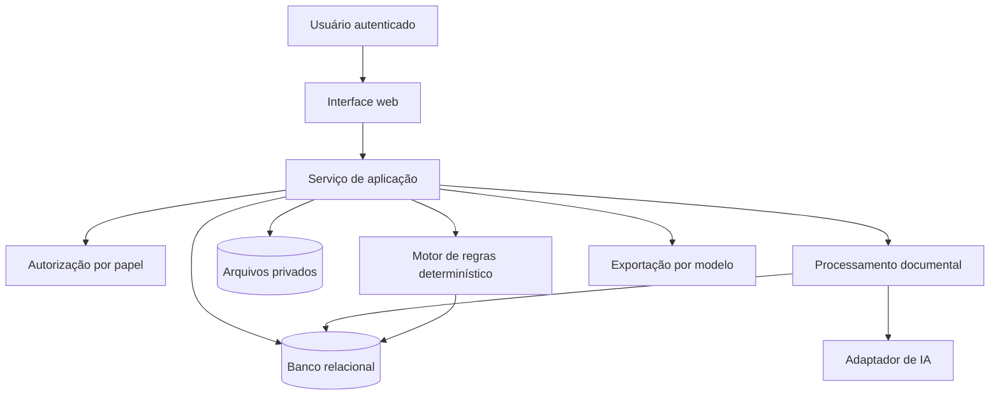
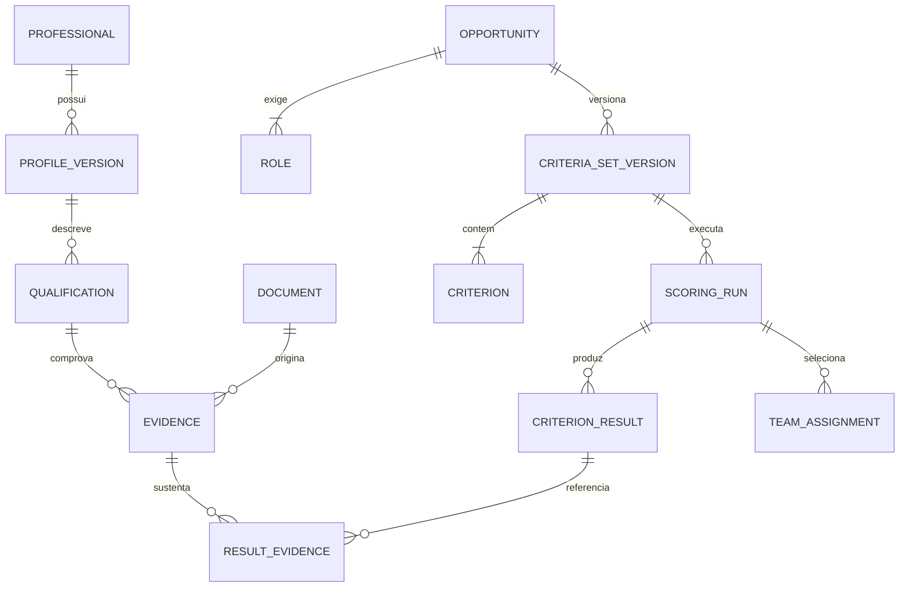

# 07 — Arquitetura e modelo de dados

## Arquitetura da primeira PoC

A direção escolhida é **front primeiro**, com perfis e critérios em JSON, cálculo determinístico no navegador e estado local para a seleção. Essa versão não depende de API, banco, login ou provedor de IA. A importação documental pode ser apresentada como simulação identificada.

Separar os componentes visuais do acesso a dados e do cálculo facilita integrar uma API depois. Uma persistência local no navegador é opcional; o cenário deve poder ser restaurado antes da apresentação.

## Arquitetura de evolução com back

Se houver tempo, acrescentar um serviço básico que consulte os perfis sintéticos e execute as mesmas regras no servidor. Persistência de cenários entra se for útil à demonstração. O [roteiro da PoC](13-desenvolvimento-da-poc.md) define esse recorte mínimo.

O diagrama e o modelo de entidades abaixo descrevem a evolução para documentos reais, acesso por usuários e histórico. Não é necessário implementar toda essa estrutura na PoC. Linguagem, bibliotecas, provedor de IA e hospedagem continuam pendentes de decisão do grupo; esta documentação não instala nem provisiona infraestrutura.

Se a extração for demorada, criar uma tarefa persistente e consultar seu estado. No MVP, um processador simples pode bastar. Fila externa e trabalhadores independentes são decisões para quando volume e disponibilidade justificarem.

## Entidades e relacionamentos

| Entidade | Campos principais | Relação e regra |
|---|---|---|
| Organization | id, nome | Contexto de isolamento, inclusive na evolução multiempresa |
| User | id, organization_id, papel | Responsável por ações; identidade separada do profissional |
| Professional | id, organization_id, nome de exibição | Perfil único; versões preservadas |
| ProfileVersion | id, professional_id, versão, revisado_por, data | Fotografia aprovada do cadastro |
| Document | id, organization_id, hash, tipo, storage_key, classificação | Arquivo privado; deduplicação não mistura organizações |
| Extraction | id, document_id, esquema, modelo, instrução_versão, estado | Saída bruta separada dos fatos aprovados |
| Qualification | id, profile_version_id, tipo, atributos | Formação, certificação ou experiência |
| Evidence | id, qualification_id, document_id, página, trecho, estado, revisor, validade | Várias evidências por fato; revisão registrada |
| Availability | id, professional_id, início, fim, dedicação, confirmado_em | Disponibilidade depende do período da disputa |
| Opportunity | id, título, prazo, data_corte, documento_id | Licitação ou concorrência privada |
| Role | id, opportunity_id, função, vagas | Requisitos específicos de cada função |
| CriteriaSetVersion | id, opportunity_id, versão, estado, aprovado_por | Rascunho e aprovado; imutável após execução |
| Criterion | id, version_id, role_id, tipo, operador, parâmetros, teto, fonte | Apenas operadores permitidos; validação de configuração |
| ScoringRun | id, criteria_version_id, data_corte, entradas, estado | Referências exatas às versões usadas |
| CriterionResult | id, run_id, professional_id, role_id, criterion_id, pontos, estado, justificativa | Uma linha por critério e profissional/função |
| ResultEvidence | criterion_result_id, evidence_id | Vínculo explícito da nota à prova |
| TeamAssignment | run_id, professional_id, role_id, aprovado_por | Restrição de vaga e duplicidade |
| AuditEvent | id, ator, ação, entidade, instante, motivo | Histórico sem currículo integral ou segredo |

O diagrama simplifica as relações para leitura; não é uma migração SQL. Campos com dados pessoais devem ser minimizados e separados dos atributos necessários ao cálculo.

## Contratos de interface propostos

| Operação | Endpoint ilustrativo | Resultado |
|---|---|---|
| Enviar documento | `POST /documents` | ID, hash e estado |
| Consultar processamento | `GET /documents/{id}/extraction` | Campos propostos e fontes |
| Aprovar revisão | `POST /profiles/{id}/reviews` | Nova versão de perfil |
| Listar perfis | `GET /professionals` | Filtros, paginação e campos autorizados |
| Criar disputa | `POST /opportunities` | Cadastro de funções e datas |
| Gravar critérios em rascunho | `POST /opportunities/{id}/criteria-versions` | Nova versão |
| Aprovar critérios | `POST /criteria-versions/{id}/approval` | Versão apta a executar |
| Executar cálculo | `POST /opportunities/{id}/runs` | Execução e versão das entradas |
| Ler explicação | `GET /runs/{id}/results` | Critérios, pontos e evidências autorizadas |
| Aprovar equipe | `POST /runs/{id}/team` | Composição validada e responsável |
| Exportar relatório | `POST /runs/{id}/exports` | Arquivo protegido e versão |

São propostas de contratos; não há endpoints implementados. A autorização precisa ocorrer no servidor em cada operação e objeto. IDs imprevisíveis não substituem controle de acesso.

## Integridade e persistência

- Versões de regras e de perfis referenciadas por execuções não devem ser editadas no lugar.
- Critérios aprovados exigem tipos válidos, tetos não negativos e política para obrigatórios e grupos exclusivos.
- Evitar duplicidade de resultado por execução/profissional/função/critério.
- Upload e revisão devem permitir repetição segura, sem criar vários perfis iguais.
- Configurar acesso a arquivos por identificador interno, sem aceitar caminhos arbitrários do cliente.
- Registrar exclusão ou restrição de acesso de dados pessoais também nas exportações e cópias derivadas, conforme a política definida pela organização.

## Ambiente pessoal do hackathon

Todo desenvolvimento deste projeto deve ficar neste repositório e usar dados e credenciais próprios do hackathon. Não importar código, arquivos, tokens ou dados de organizações empregadoras. Credenciais futuras devem ser locais e ignoradas pelo Git; o isolamento de permissões do Codex e dos conectores é configuração do ambiente, não algo garantido apenas por um documento no repositório.
