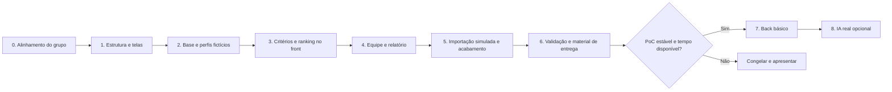

# 13 — Desenvolvimento da PoC: front primeiro

**Roteiro inicial para discussão e divisão de trabalho entre os integrantes.** A prioridade definida pela equipe é demonstrar o produto com uma interface funcional e dados fictícios. Um back básico entra depois, se houver tempo. As etapas abaixo descrevem trabalho futuro; ainda não há aplicação implementada.

O objetivo da PoC é permitir que alguém percorra a solução e entenda a escolha de profissionais: abrir a base, consultar um perfil, definir critérios, ver pontos e pendências, selecionar uma equipe e gerar uma saída compreensível.

## 1. Escopo acordado para orientar o desenvolvimento

| Camada | Entrega principal | Abordagem inicial |
|---|---|---|
| Front | Telas e navegação da jornada | Aplicação no navegador |
| Dados | Perfis, critérios, evidências e disponibilidade | JSON sintético já existente em `docs/exemplos` |
| Pontuação | Cálculo e explicação por critério | Funções determinísticas no front |
| Seleção | Uma função com uma vaga | Escolha assistida e validação das restrições |
| Importação | Experiência visual de envio e revisão | Fluxo simulado, identificado na tela |
| Relatório | Equipe, pontos e pendências | Visualização para impressão ou exportação simples |
| Persistência | Manter cenário durante a demonstração | Memória e, opcionalmente, armazenamento local |
| Back | Ler base, executar cálculo e salvar cenário | Opcional após a jornada principal estar pronta |
| IA real | Extrair campos de um documento sintético | Extensão opcional depois do back |

Selecionar um arquivo no navegador não significa enviá-lo para um serviço ou extrair seu conteúdo com IA. A tela deve informar o comportamento real. Uma ação “simular importação” pode carregar um resultado fictício previamente preparado e mostrar a etapa de revisão.

## 2. Ordem de desenvolvimento



O primeiro percurso completo pode ser construído sem a tela de importação. Isso permite demonstrar o valor principal enquanto outros integrantes preparam o cenário de extração e revisão.

## Etapa 0 — Alinhamento e preparação

**Objetivo:** todos entenderem o mesmo produto e conseguirem trabalhar sem esperar uma API.

**O que fazer:**

1. Ler o case, as regras do evento e esta proposta; registrar ajustes do grupo.
2. Confirmar a jornada principal e o caso de uma vaga com teto de 28 pontos.
3. Definir nome da equipe, responsáveis por frentes e quem integra o trabalho.
4. Escolher a tecnologia de front que o grupo já conhece. Não é necessário estudar uma arquitetura nova para esta PoC.
5. Conferir os JSON de perfis, critérios e resultados de referência.
6. Desenhar esboços simples das telas e combinar rótulos, cores e componentes básicos.
7. Definir a forma de executar localmente e registrar o comando no README quando houver código.

**Entrega:** escopo de uma página aprovado pelo grupo, responsáveis preenchidos e esboço da navegação.

**Condição para avançar:** uma pessoa consegue explicar o fluxo e o que é simulado sem depender de suposições diferentes das dos colegas.

## Etapa 1 — Estrutura do front e navegação

**Objetivo:** colocar o esqueleto visual da solução em funcionamento.

**O que fazer:**

- Criar o projeto de front e organizar páginas, componentes, tipos, dados e serviços de acesso aos dados.
- Implementar estrutura com cabeçalho, navegação, área de conteúdo e indicação “PoC com dados fictícios”.
- Criar as páginas inicialmente com conteúdo de exemplo simples.
- Definir hierarquia visual para ações principais, tabelas, alertas e pontuação.
- Prever estados de carregamento, lista vazia, erro e resultado sem candidatos.
- Garantir legibilidade em notebook, tamanho confortável de texto e navegação por teclado nos controles principais.

**Páginas sugeridas:**

| Página | Pergunta que responde | Conteúdo mínimo |
|---|---|---|
| Base de profissionais | Quem está disponível na base? | Busca, filtros, lista e acesso ao perfil |
| Perfil do profissional | Quais qualificações e evidências ele possui? | Histórico, certificações e pendências |
| Disputa e critérios | Quais regras queremos avaliar? | Função, vaga, data de corte, critérios e tetos |
| Ranking | Como cada pessoa atende às regras? | Elegibilidade, nota e explicação |
| Equipe e relatório | Quem escolhemos e por quê? | Seleção, validação e resumo exportável |
| Importação e revisão | Como os dados entram na base? | Fluxo simulado com aviso claro |

Um painel geral com gráficos é complementar. A lista de profissionais e o fluxo de seleção devem funcionar primeiro.

**Entrega:** navegação completa entre as telas, com layout consistente.

**Condição para avançar:** abrir as páginas sem links quebrados; identificar visualmente onde começa e termina a jornada. A aplicação ainda pode usar conteúdo estático nessa etapa.

## Etapa 2 — Base fictícia, listagem e perfil

**Objetivo:** transformar o esqueleto em uma interface explorável.

**O que fazer:**

1. Carregar os 12 perfis de [perfis-demonstracao.json](exemplos/perfis-demonstracao.json).
2. Criar um modelo de dados compartilhado e um adaptador para ler o JSON, evitando estruturas diferentes em cada tela.
3. Implementar busca por nome e filtros de certificação, experiência, formação e disponibilidade.
4. Mostrar quantidade de resultados e permitir limpar todos os filtros.
5. Abrir o perfil pelo identificador e mostrar a visão detalhada, inclusive campos ausentes.
6. Mostrar evidências como registros fictícios, com estado e referência. Os JSON não incluem arquivos de comprovantes; não criar botões de download para arquivos inexistentes.
7. Exibir pendências e diferenciar certificado vencido de certificado sem comprovação.

**Componentes úteis:** campo de busca, filtros, tabela/lista de profissionais, etiqueta de disponibilidade, estado de comprovação, seção de experiências e painel de evidências.

**Entrega:** pessoa pode encontrar um perfil e entender suas qualificações e limitações.

**Condição para avançar:** lista e detalhe exibem os mesmos dados; filtros funcionam; campos ausentes não viram informação inventada. Comparar Ana, Carla e Diego para preparar a demonstração.

## Etapa 3 — Critérios editáveis e ranking calculado no front

**Objetivo:** demonstrar a principal lógica de negócio sem depender do back.

**O que fazer:**

- Criar formulário da disputa com título, função, uma vaga, período e data de corte.
- Apresentar os quatro critérios do exemplo: PMP, projetos de energia, pós-graduação e experiência.
- Permitir ativar/desativar critérios e alterar pontos/tetos nos limites suportados, identificando o resultado como simulação.
- Validar números negativos, campos vazios, data inválida e configuração sem critérios pontuáveis.
- Calcular elegibilidade, pontos comprovados e cenário com pendências usando funções puras, separadas dos componentes visuais.
- Ordenar os elegíveis por score comprovado; exibir inelegíveis e pendentes em uma área identificada.
- Abrir explicação por critério: dado observado, referência, regra, pontos, teto e pendência.
- Manter uma versão do cenário em memória para não misturar resultados antigos e regras novas.

**Cuidados do cálculo:** aplicar teto; contar projetos distintos; comparar experiência no calendário; tratar exatamente dez anos corretamente; verificar validade na data de corte; não transformar pendência em ponto comprovado.

**Entrega:** ranking muda de forma coerente ao alterar critérios e explica como a nota foi obtida.

**Condição para avançar:** configuração inicial reproduz os [resultados esperados](exemplos/resultados-esperados.json). Ana: 28; Carla: 18 comprovados e 10 pendentes; Diego: 28, mas inelegível por indisponibilidade. O resultado não pode ser apenas uma tabela fixa com números decorativos.

## Etapa 4 — Seleção de equipe e relatório

**Objetivo:** fechar a jornada de decisão.

**O que fazer:**

1. Adicionar ação para selecionar um profissional elegível e trocar a escolha.
2. Respeitar uma vaga e impedir seleção final de pessoa indisponível ou com requisito obrigatório pendente.
3. Mostrar score, pendências, data de corte e critérios usados na seleção.
4. Criar uma prévia de currículo padronizado com fatos sintéticos aprovados no cenário.
5. Criar relatório da escolha com tabela de pontos e referências das evidências simuladas.
6. Oferecer impressão da página ou exportação simples de JSON/HTML, conforme o tempo. PDF com diagramação especial é complemento.
7. Incluir marcação de PoC/dados fictícios nos arquivos gerados.

**Entrega:** fluxo completo de base → critérios → ranking → escolha → relatório.

**Condição para avançar:** outra pessoa consegue executar a jornada sem instruções do desenvolvedor; relatório corresponde à seleção e às regras que estão na tela.

**Limite inicial:** seleção de uma função com uma vaga. Múltiplos papéis e busca da melhor combinação são expansão depois desse percurso. Um seletor manual não deve ser apresentado como algoritmo de otimização já implementado.

## Etapa 5 — Importação simulada e acabamento da PoC

**Objetivo:** mostrar como a futura solução recebe os documentos e tornar a demonstração estável.

**O que fazer:**

- Criar etapa “Simular importação de currículo” e selecionar um perfil de exemplo preparado.
- Mostrar progresso simulado, resultado da extração e campos para conferência.
- Permitir corrigir um campo no estado local e aceitar/rejeitar um fato de demonstração.
- Mostrar origem como exemplo fictício. Se houver prévia de documento, produzir um arquivo sintético e incluí-lo no projeto.
- Recalcular o ranking se a revisão mudar um fato ou estado de comprovação.
- Permitir restaurar o cenário inicial para repetir o pitch. Se houver armazenamento local, o botão também precisa limpar esse estado.
- Revisar mensagens, contraste, estados vazios e feedback de ações.
- Preparar alternativas em caso de falha: imagens do percurso e vídeo curto gravado a partir da PoC real.

**Entrega:** demonstração dos pontos de entrada e revisão, conectada à base local.

**Condição para avançar:** nenhum processamento simulado é chamado de IA real; é possível demonstrar e reiniciar o cenário de maneira previsível.

## Etapa 6 — Validação pelo grupo e fechamento das entregas

**Objetivo:** verificar a ideia e preparar o que a banca vai avaliar.

**O que fazer:**

1. Pedir a um integrante que não construiu determinada tela para percorrê-la.
2. Conferir os casos de referência e anotar erros de regra e de entendimento.
3. Registrar o que foi efetivamente construído e o que permanece simulado ou planejado.
4. Medir o tempo da jornada da interface separadamente do processamento documental, que ainda não existe se for simulado.
5. Escolher os trechos da PoC que sustentam o pitch; retirar telas incompletas do percurso principal.
6. Revisar e diagramar o resumo, gravar vídeo e conferir as obrigações do regulamento.

**Entrega:** PoC estável, lista conhecida de limitações e materiais revisados pelo grupo.

**Condição para avançar ao back:** jornada principal está pronta, resultados batem com a referência, resumo/vídeo já têm responsáveis e a integração adicional não compromete o prazo. Se essas condições não forem atendidas, finalizar a apresentação com a PoC de front.

## Etapa 7 — Back básico opcional

**Objetivo:** substituir o acesso ao JSON por uma API pequena, preservando a interface já pronta.

**Primeira versão do back:**

| Capacidade | O que implementar | O que o front muda |
|---|---|---|
| Consulta de profissionais | Ler a mesma base sintética e responder lista/detalhe | Trocar a implementação do adaptador de dados |
| Consulta de critérios | Retornar configuração inicial | Carregar a configuração pelo mesmo contrato |
| Execução de pontuação | Receber critérios suportados e calcular resultado no servidor | Enviar cenário e exibir a resposta |
| Salvar cenário, se necessário | Guardar critérios e seleção em persistência local simples | Adicionar salvar/carregar |

**Endpoints mínimos sugeridos:**

- `GET /professionals`
- `GET /professionals/{id}`
- `GET /demo/criteria`
- `POST /scoring-runs`
- `GET /scoring-runs/{id}` somente se houver persistência das execuções.

Definir os corpos e erros com o grupo antes de implementar. Não exigir nesta PoC todas as entidades ou operações da arquitetura futura do capítulo 07. O primeiro back pode usar a base em memória; um banco relacional local simples entra apenas se salvar e recuperar cenários fizer parte da demonstração.

No cálculo pelo servidor, dados profissionais e estados de comprovação devem vir da base do servidor. O cliente envia a configuração permitida; não envia uma nota pronta para ser aceita como resultado oficial.

**Sequência:** criar serviço → servir a base → validar contratos → implementar cálculo → comparar com a referência → conectar o adaptador do front → conferir a jornada completa.

**Entrega:** o mesmo percurso demonstrável usando API, com erros e carregamento tratados. A alternativa com dados locais pode continuar disponível como modo explicitamente identificado.

**Condição para concluir:** mesma configuração gera os mesmos resultados no cenário local e no servidor; uma falha de rede não deixa a tela mostrando uma nota antiga como se fosse o resultado novo.

## Etapa 8 — Extração real por IA, somente se couber

**Objetivo:** demonstrar uma extração real de um arquivo sintético após a PoC e o back estarem estáveis.

**O que fazer:** receber um PDF textual sintético; obter texto; chamar o provedor escolhido; validar a estrutura; mostrar campos e trechos na tela de revisão. Começar com um documento conhecido e medir erros e tempo. Se o arquivo exigir OCR e essa capacidade não estiver pronta, informar a limitação.

Credenciais e chamadas autenticadas de IA ficam no servidor. A interface continua funcionando com os dados locais quando a extração falha, indicando a mudança de modo. A saída da IA continua sujeita à revisão; um campo extraído não altera sozinho sua comprovação.

**Entrega:** um exemplo real de extração conectado à revisão e identificado no pitch como tal. Não declarar suporte amplo a documentos com base em um único exemplo.

## 3. Como organizar o front para permitir o back depois

Estrutura ilustrativa, adaptável à tecnologia escolhida:

```text
src/
  pages/             # páginas da jornada
  components/        # filtros, listas, formulários e explicações
  domain/            # tipos e regras de cálculo
  services/          # interface de acesso aos dados
  data/              # perfis e critérios sintéticos
  state/             # cenário, regras e seleção atuais
```

Concentrar o acesso a dados em funções como `listProfessionals`, `getProfessional`, `getCriteria` e `runScoring`. Na primeira etapa elas usam arquivos locais e cálculo no navegador. Depois, uma implementação alternativa chama a API e retorna o mesmo formato lógico. Os componentes não precisam saber a origem dos dados.

Não criar uma falsa camada de segurança com um login desenhado no front. Para esta PoC, usar apenas dados sintéticos; autenticação e autorização reais pertencem à evolução para usuários e documentos reais, descrita no capítulo 08.

## 4. O que pode ser reduzido se o prazo apertar

Preservar primeiro: lista, perfil, formulário de critérios, cálculo explicável, uma seleção válida e relatório simples. Reduzir acabamento adicional, painel de indicadores, importação simulada extensa, persistência e seleção com várias funções. Back e IA real só entram com a base da PoC estável.

O [backlog do grupo](14-backlog-e-colaboracao.md) desdobra estas etapas em tarefas que podem ser assumidas por integrantes diferentes.
