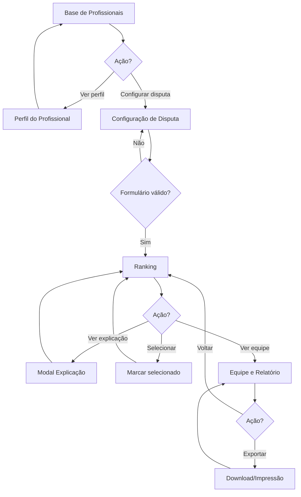
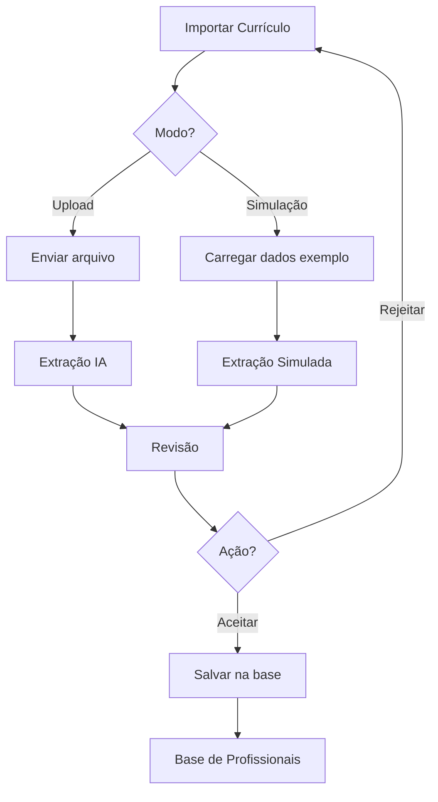

# 15 — Especificação do Frontend

> Documentação completa de design system, páginas, componentes e interações da interface web do Smart CV Matcher.

**Versão:** 1.1  
**Última atualização:** 21/10/2026  
**Status:** Especificação para implementação

### Mudanças na Versão 1.1

- Adicionadas especificações de Stack Tecnológica
- Incluídas diretrizes de Estado Global e Gerenciamento de Dados
- Especificados padrões de Performance e Otimização
- Documentadas convenções de Testes e Qualidade de Código

---

## Índice

1. [Visão Geral](#visão-geral)
2. [Stack Tecnológica](#stack-tecnológica)
3. [System Design](#system-design)
4. [Páginas](#páginas)
5. [Componentes](#componentes)
6. [Estados e Interações](#estados-e-interações)
7. [Fluxos de Navegação](#fluxos-de-navegação)
8. [Responsividade](#responsividade)
9. [Acessibilidade](#acessibilidade)
10. [Performance e Otimização](#performance-e-otimização)
11. [Testes](#testes)

---

## Stack Tecnológica

### Framework e Bibliotecas Core

| Tecnologia | Versão | Propósito |
|------------|--------|-----------|
| **React** | 18+ | Framework UI |
| **TypeScript** | 5+ | Tipagem estática |
| **Vite** | 5+ | Build tool e dev server |
| **React Router** | 6+ | Roteamento SPA |
| **TanStack Query (React Query)** | 5+ | Gerenciamento de estado server |
| **Zustand** | 4+ | Gerenciamento de estado client |

### UI e Estilos

| Tecnologia | Propósito |
|------------|-----------|
| **Tailwind CSS** | Utility-first CSS framework |
| **shadcn/ui** | Componentes reutilizáveis |
| **Radix UI** | Primitivos acessíveis (base do shadcn) |
| **Lucide React** | Ícones SVG |
| **date-fns** | Manipulação de datas |

### Validação e Formulários

| Tecnologia | Propósito |
|------------|-----------|
| **React Hook Form** | Gerenciamento de formulários |
| **Zod** | Schema validation |

### Cliente HTTP e API

| Tecnologia | Propósito |
|------------|-----------|
| **Axios** | Cliente HTTP |
| **MSW (Mock Service Worker)** | Mock de API para desenvolvimento |

### Testes

| Tecnologia | Propósito |
|------------|-----------|
| **Vitest** | Test runner |
| **Testing Library** | Testes de componentes |
| **Playwright** | Testes E2E |
| **MSW** | Mock de API em testes |

### Estrutura de Diretórios

```
src/
├── api/                    # Camada de abstração da API
│   ├── client.ts          # Cliente Axios configurado
│   ├── types.ts           # Tipos TypeScript da API
│   └── endpoints/         # Funções de endpoint por domínio
│       ├── professionals.ts
│       ├── disputes.ts
│       └── rankings.ts
├── components/            # Componentes reutilizáveis
│   ├── ui/               # Componentes base (shadcn)
│   ├── domain/           # Componentes de domínio
│   └── layout/           # Componentes de layout
├── pages/                # Páginas da aplicação
│   ├── Professionals/
│   ├── ProfessionalDetail/
│   ├── DisputeConfig/
│   ├── Ranking/
│   ├── Team/
│   └── Import/
├── hooks/                # Hooks customizados
│   ├── useProfiles.ts
│   ├── useRanking.ts
│   └── useDisputeConfig.ts
├── store/                # Estado global (Zustand)
│   ├── disputeStore.ts
│   └── uiStore.ts
├── lib/                  # Utilitários e configurações
│   ├── utils.ts
│   ├── cn.ts            # Tailwind merge
│   └── scoring.ts       # Lógica de pontuação
├── types/                # Tipos globais
│   └── index.ts
├── mocks/                # Dados mockados
│   ├── handlers.ts      # MSW handlers
│   ├── data/           # JSON fixtures
│   └── browser.ts      # MSW setup
└── App.tsx

```

### Gerenciamento de Estado

#### Estado Server (TanStack Query)

```typescript
// hooks/useProfiles.ts
import { useQuery, useMutation } from '@tanstack/react-query';
import { getProfiles, getProfessionalById } from '@/api/endpoints/professionals';

export function useProfiles(filters?: ProfileFilters) {
  return useQuery({
    queryKey: ['professionals', filters],
    queryFn: () => getProfiles(filters),
    staleTime: 5 * 60 * 1000, // 5 minutos
  });
}

export function useProfessional(id: string) {
  return useQuery({
    queryKey: ['professional', id],
    queryFn: () => getProfessionalById(id),
    enabled: !!id,
  });
}
```

#### Estado Client (Zustand)

```typescript
// store/disputeStore.ts
import { create } from 'zustand';
import { persist } from 'zustand/middleware';

interface DisputeState {
  config: DisputeConfig | null;
  selectedProfessionals: string[];
  setConfig: (config: DisputeConfig) => void;
  toggleSelection: (id: string) => void;
  clearSelections: () => void;
}

export const useDisputeStore = create<DisputeState>()(
  persist(
    (set) => ({
      config: null,
      selectedProfessionals: [],
      setConfig: (config) => set({ config }),
      toggleSelection: (id) =>
        set((state) => ({
          selectedProfessionals: state.selectedProfessionals.includes(id)
            ? state.selectedProfessionals.filter((p) => p !== id)
            : [...state.selectedProfessionals, id],
        })),
      clearSelections: () => set({ selectedProfessionals: [] }),
    }),
    { name: 'dispute-storage' }
  )
);
```

### Convenções de Código

#### Naming Conventions

| Tipo | Convenção | Exemplo |
|------|-----------|---------|
| **Componentes** | PascalCase | `ProfessionalCard` |
| **Hooks** | camelCase com prefixo use | `useProfiles` |
| **Tipos/Interfaces** | PascalCase | `Professional`, `DisputeConfig` |
| **Funções** | camelCase | `calculateScore` |
| **Constantes** | UPPER_SNAKE_CASE | `MAX_UPLOAD_SIZE` |
| **Arquivos** | kebab-case | `professional-card.tsx` |

#### Imports Order

```typescript
// 1. External dependencies
import React from 'react';
import { useQuery } from '@tanstack/react-query';

// 2. Internal absolute imports (@/)
import { Button } from '@/components/ui/button';
import { useProfiles } from '@/hooks/useProfiles';

// 3. Relative imports
import { ScoreBar } from './score-bar';

// 4. Types
import type { Professional } from '@/types';
```

---

## Visão Geral

### Princípios de Design

1. **Clareza acima de tudo**: Cada elemento deve comunicar seu propósito instantaneamente
2. **Rastreabilidade explícita**: Toda pontuação deve ser explicável com um clique
3. **Estados visíveis**: Distinguir claramente comprovado, pendente, vencido e ausente
4. **Feedback imediato**: Validações e ações devem ter resposta instantânea
5. **Hierarquia clara**: Ações primárias destacadas, secundárias discretas

### Tom Visual

- **Profissional**: Cores sóbrias, tipografia legível
- **Moderno**: Interface limpa, espaçamento generoso
- **Confiável**: Informações precisas, sem promessas excessivas
- **Transparente**: Badges e rótulos explicam o que está acontecendo

---

## System Design

### Paleta de Cores

```css
/* Cores Primárias */
--primary-50: #eff6ff;    /* Background claro */
--primary-100: #dbeafe;   /* Hover states */
--primary-500: #3b82f6;   /* Primary actions */
--primary-600: #2563eb;   /* Primary hover */
--primary-700: #1d4ed8;   /* Primary active */

/* Cores de Status */
--success-50: #f0fdf4;
--success-500: #22c55e;   /* Comprovado */
--success-600: #16a34a;

--warning-50: #fffbeb;
--warning-500: #f59e0b;   /* Pendente */
--warning-600: #d97706;

--error-50: #fef2f2;
--error-500: #ef4444;     /* Vencido / Erro */
--error-600: #dc2626;

--neutral-50: #fafafa;
--neutral-100: #f5f5f5;
--neutral-300: #d4d4d4;
--neutral-500: #737373;
--neutral-700: #404040;
--neutral-900: #171717;

/* Background */
--bg-page: #fafafa;
--bg-card: #ffffff;
--bg-elevated: #ffffff;
```

### Tipografia

```css
/* Font Family */
--font-sans: 'Inter', -apple-system, BlinkMacSystemFont, 'Segoe UI', sans-serif;
--font-mono: 'JetBrains Mono', 'Fira Code', monospace;

/* Font Sizes */
--text-xs: 0.75rem;     /* 12px - Labels pequenos */
--text-sm: 0.875rem;    /* 14px - Texto secundário */
--text-base: 1rem;      /* 16px - Texto padrão */
--text-lg: 1.125rem;    /* 18px - Subtítulos */
--text-xl: 1.25rem;     /* 20px - Títulos de seção */
--text-2xl: 1.5rem;     /* 24px - Títulos de página */
--text-3xl: 1.875rem;   /* 30px - Títulos principais */

/* Font Weights */
--font-normal: 400;
--font-medium: 500;
--font-semibold: 600;
--font-bold: 700;

/* Line Heights */
--leading-tight: 1.25;
--leading-normal: 1.5;
--leading-relaxed: 1.625;
```

### Espaçamento

```css
--space-1: 0.25rem;   /* 4px */
--space-2: 0.5rem;    /* 8px */
--space-3: 0.75rem;   /* 12px */
--space-4: 1rem;      /* 16px */
--space-5: 1.25rem;   /* 20px */
--space-6: 1.5rem;    /* 24px */
--space-8: 2rem;      /* 32px */
--space-10: 2.5rem;   /* 40px */
--space-12: 3rem;     /* 48px */
--space-16: 4rem;     /* 64px */
```

### Border Radius

```css
--radius-sm: 0.25rem;   /* 4px - Badges */
--radius-md: 0.375rem;  /* 6px - Inputs */
--radius-lg: 0.5rem;    /* 8px - Cards */
--radius-xl: 0.75rem;   /* 12px - Modais */
--radius-full: 9999px;  /* Pills */
```

### Shadows

```css
--shadow-sm: 0 1px 2px 0 rgb(0 0 0 / 0.05);
--shadow-md: 0 4px 6px -1px rgb(0 0 0 / 0.1);
--shadow-lg: 0 10px 15px -3px rgb(0 0 0 / 0.1);
--shadow-xl: 0 20px 25px -5px rgb(0 0 0 / 0.1);
```

---

## Páginas

### Visão Geral das Páginas

```
┌─────────────────────────────────────────────────────────────┐
│                         LAYOUT                               │
│  ┌─────────────────────────────────────────────────────┐    │
│  │  HEADER (Logo, Badge PoC, Navigation, Status)       │    │
│  └─────────────────────────────────────────────────────┘    │
│  ┌─────────────────────────────────────────────────────┐    │
│  │                                                     │    │
│  │                   CONTEÚDO                          │    │
│  │              (Área principal)                       │    │
│  │                                                     │    │
│  └─────────────────────────────────────────────────────┘    │
│  ┌─────────────────────────────────────────────────────┐    │
│  │  FOOTER (Versão, links, aviso dados fictícios)      │    │
│  └─────────────────────────────────────────────────────┘    │
└─────────────────────────────────────────────────────────────┘
```

---

### Página 1: Base de Profissionais

**Rota:** `/profissionais`  
**Objetivo:** Listar, buscar e filtrar profissionais da base

#### Layout

```
┌─────────────────────────────────────────────────────────────┐
│  BASE DE PROFISSIONAIS                           12 perfis   │
├─────────────────────────────────────────────────────────────┤
│  ┌─────────────────────────────────────────────────────┐    │
│  │ 🔍 Buscar por nome...              [Limpar filtros] │    │
│  └─────────────────────────────────────────────────────┘    │
│                                                             │
│  ┌──────────┬──────────┬──────────┬──────────┐            │
│  │ PMP      │ Pós      │ Exp.     │ Disp.    │            │
│  │ [Todos ▼]│ [Todos ▼]│ [Todos ▼]│ [Todos ▼]│            │
│  └──────────┴──────────┴──────────┴──────────┘            │
│                                                             │
│  ┌─────────────────────────────────────────────────────┐    │
│  │  👤 Ana Exemplo                         ✅ Disponível│    │
│  │  PMP ✅ | Pós ✅ | 4 projetos | 16 anos              │    │
│  │  Score: 28 pts                                     │    │
│  │  [Ver perfil →]                                    │    │
│  └─────────────────────────────────────────────────────┘    │
│                                                             │
│  ┌─────────────────────────────────────────────────────┐    │
│  │  👤 Bruno Exemplo                      ✅ Disponível│    │
│  │  PMP ✅ | Pós ✅ | 3 projetos | 14 anos              │    │
│  │  Score: 23 pts                                     │    │
│  │  [Ver perfil →]                                    │    │
│  └─────────────────────────────────────────────────────┘    │
│                                                             │
│  ┌─────────────────────────────────────────────────────┐    │
│  │  👤 Carla Exemplo                      ✅ Disponível│    │
│  │  PMP ⏳ Pendente | Pós ✅ | 4 projetos | 15 anos     │    │
│  │  Score: 18 pts (10 pendentes)                      │    │
│  │  [Ver perfil →]                                    │    │
│  └─────────────────────────────────────────────────────┘    │
│                                                             │
│  ...                                                        │
│                                                             │
│  [Carregar mais]                                           │
└─────────────────────────────────────────────────────────────┘
```

#### Componentes da Página

| Componente | Descrição |
|------------|-----------|
| `SearchBar` | Campo de busca por nome com debounce |
| `FilterBar` | Filtros dropdown para PMP, Pós, Experiência, Disponibilidade |
| `ProfessionalCard` | Card com resumo do perfil e ações |
| `AvailabilityBadge` | Badge de disponibilidade (disponível/indisponível) |
| `ScorePreview` | Prévia da pontuação com indicador de pendências |

#### Filtros Disponíveis

| Filtro | Opções |
|--------|--------|
| **PMP** | Todos, Com certificado, Sem certificado, Vencido, Pendente |
| **Pós-graduação** | Todos, Com pós, Sem pós, Pendente |
| **Experiência** | Todos, 5+ anos, 10+ anos, 15+ anos |
| **Disponibilidade** | Todos, Disponível, Indisponível |

#### Interações

- **Clicar em "Ver perfil"**: Navega para `/profissionais/:id`
- **Digitar na busca**: Filtra lista em tempo real (debounce 300ms)
- **Selecionar filtro**: Atualiza lista instantaneamente
- **Limpar filtros**: Remove todos os filtros ativos
- **Clicar no card**: Expande prévia ou navega para perfil

---

### Página 2: Perfil do Profissional

**Rota:** `/profissionais/:id`  
**Objetivo:** Exibir detalhes completos do profissional com evidências

#### Layout

```
┌─────────────────────────────────────────────────────────────┐
│  [← Voltar para base]                                       │
├─────────────────────────────────────────────────────────────┤
│                                                             │
│  ┌─────────────────────────────────────────────────────┐    │
│  │  👤 Ana Exemplo                         ✅ Disponível│    │
│  │  ID: P001 | Atualizado: 21/10/2026                  │    │
│  └─────────────────────────────────────────────────────┘    │
│                                                             │
│  ┌─────────────────────────────────────────────────────┐    │
│  │  RESUMO DE QUALIFICAÇÕES                            │    │
│  │  ┌───────────┬───────────┬───────────┐             │    │
│  │  │ PMP       │ Pós       │ Projetos  │             │    │
│  │  │ ✅ 10 pts │ ✅ 5 pts  │ ✅ 8 pts  │             │    │
│  │  │ Válido    │ Aprovada  │ 4 projetos│             │    │
│  │  └───────────┴───────────┴───────────┘             │    │
│  │  ┌───────────┬──────────────────────┐              │    │
│  │  │ Exp.      │ SCORE TOTAL          │              │    │
│  │  │ ✅ 5 pts  │ 🏆 28 / 28 pts       │              │    │
│  │  │ 16 anos   │ Máximo possível      │              │    │
│  │  └───────────┴──────────────────────┘              │    │
│  └─────────────────────────────────────────────────────┘    │
│                                                             │
│  ┌─────────────────────────────────────────────────────┐    │
│  │  CERTIFICAÇÕES                                      │    │
│  │  ┌─────────────────────────────────────────────┐    │    │
│  │  │ PMP - Project Management Professional       │    │    │
│  │  │ Status: ✅ Comprovado                        │    │    │
│  │  │ Validade: até 31/12/2027                    │    │    │
│  │  │ Evidência: synthetic:P001:pmp               │    │    │
│  │  │ Revisado: 21/10/2026                        │    │    │
│  │  └─────────────────────────────────────────────┘    │    │
│  └─────────────────────────────────────────────────────┘    │
│                                                             │
│  ┌─────────────────────────────────────────────────────┐    │
│  │  FORMAÇÃO ACADÊMICA                                  │    │
│  │  ┌─────────────────────────────────────────────┐    │    │
│  │  │ Pós-graduação em Gestão de Projetos         │    │    │
│  │  │ Status: ✅ Comprovado | Concluída           │    │    │
│  │  │ Relevância: ✅ Aprovada                     │    │    │
│  │  │ Evidência: synthetic:P001:postgraduate      │    │    │
│  │  └─────────────────────────────────────────────┘    │    │
│  └─────────────────────────────────────────────────────┘    │
│                                                             │
│  ┌─────────────────────────────────────────────────────┐    │
│  │  EXPERIÊNCIA PROFISSIONAL (16 anos)                 │    │
│  │  Período: 01/01/2010 - 21/10/2026                   │    │
│  │  Evidência: synthetic:P001:career                   │    │
│  └─────────────────────────────────────────────────────┘    │
│                                                             │
│  ┌─────────────────────────────────────────────────────┐    │
│  │  PROJETOS DE ENERGIA (4 projetos)                   │    │
│  │  ┌─────────────────────────────────────────────┐    │    │
│  │  │ • Projeto sintético de energia 1            │    │    │
│  │  │   ✅ Comprovado | ID: P001-ENERGIA-01       │    │    │
│  │  ├─────────────────────────────────────────────┤    │    │
│  │  │ • Projeto sintético de energia 2            │    │    │
│  │  │   ✅ Comprovado | ID: P001-ENERGIA-02       │    │    │
│  │  ├─────────────────────────────────────────────┤    │    │
│  │  │ • Projeto sintético de energia 3            │    │    │
│  │  │   ✅ Comprovado | ID: P001-ENERGIA-03       │    │    │
│  │  ├─────────────────────────────────────────────┤    │    │
│  │  │ • Projeto sintético de energia 4            │    │    │
│  │  │   ✅ Comprovado | ID: P001-ENERGIA-04       │    │    │
│  │  └─────────────────────────────────────────────┘    │    │
│  └─────────────────────────────────────────────────────┘    │
│                                                             │
│  ┌─────────────────────────────────────────────────────┐    │
│  │  DISPONIBILIDADE                                     │    │
│  │  Período: 01/11/2026 - 30/04/2027                   │    │
│  │  Status: ✅ Disponível                              │    │
│  └─────────────────────────────────────────────────────┘    │
│                                                             │
│  [← Anterior]                              [Próximo →]     │
└─────────────────────────────────────────────────────────────┘
```

#### Seções do Perfil

| Seção | Campos | Badge de Status |
|-------|--------|-----------------|
| **Certificações** | Nome, validade, evidência, revisado | Comprovado / Pendente / Vencido |
| **Formação** | Nome, status, relevância, evidência | Comprovado / Pendente / Não possui |
| **Experiência** | Período, anos totais, evidência | Comprovado / Pendente |
| **Projetos** | Nome, ID canônico, setor, evidência | Comprovado / Pendente |
| **Disponibilidade** | Período, status | Disponível / Indisponível |

#### Botões e Ações

| Botão | Ação |
|-------|------|
| **← Voltar para base** | Navega para `/profissionais` |
| **← Anterior** | Navega para perfil anterior |
| **Próximo →** | Navega para próximo perfil |

---

### Página 3: Configuração de Disputa

**Rota:** `/disputa`  
**Objetivo:** Definir parâmetros da disputa e critérios de pontuação

#### Layout

```
┌─────────────────────────────────────────────────────────────┐
│  NOVA DISPUTA                                               │
├─────────────────────────────────────────────────────────────┤
│                                                             │
│  ┌─────────────────────────────────────────────────────┐    │
│  │  INFORMAÇÕES GERAIS                                 │    │
│  │                                                      │    │
│  │  Título da Disputa *                                │    │
│  │  [Concorrência Energia - Edital 001/2026         ] │    │
│  │                                                      │    │
│  │  Função *                                           │    │
│  │  [Gerente de Projetos                ▼]            │    │
│  │                                                      │    │
│  │  Número de Vagas *                                  │    │
│  │  [1]                                                 │    │
│  │                                                      │    │
│  │  Data de Corte *                                    │    │
│  │  [21/10/2026 📅]                                    │    │
│  │                                                      │    │
│  │  Período do Projeto                                 │    │
│  │  Início: [01/11/2026]  Fim: [30/04/2027]          │    │
│  └─────────────────────────────────────────────────────┘    │
│                                                             │
│  ┌─────────────────────────────────────────────────────┐    │
│  │  CRITÉRIOS DE PONTUAÇÃO                 Total: 28pts│    │
│  │                                                      │    │
│  │  ┌─────────────────────────────────────────────┐    │    │
│  │  │ ☑ PMP - Certificação                        │    │    │
│  │  │ Tipo: Binário                               │    │    │
│  │  │ Pontos: [10]  Teto: [10]                    │    │    │
│  │  │ □ Obrigatório para elegibilidade            │    │    │
│  │  │ ☑ Exige validade na data de corte           │    │    │
│  │  │                                              │    │    │
│  │  │ [Remover]                                    │    │    │
│  │  └─────────────────────────────────────────────┘    │    │
│  │                                                      │    │
│  │  ┌─────────────────────────────────────────────┐    │    │
│  │  │ ☑ Projetos de Energia                       │    │    │
│  │  │ Tipo: Contagem distinta                     │    │    │
│  │  │ Pontos por projeto: [2]  Teto: [8]          │    │    │
│  │  │ Chave única: canonical_project_id           │    │    │
│  │  │                                              │    │    │
│  │  │ [Remover]                                    │    │    │
│  │  └─────────────────────────────────────────────┘    │    │
│  │                                                      │    │
│  │  ┌─────────────────────────────────────────────┐    │    │
│  │  │ ☑ Pós-graduação na área                     │    │    │
│  │  │ Tipo: Binário                               │    │    │
│  │  │ Pontos: [5]  Teto: [5]                      │    │    │
│  │  │ ☑ Exige conclusão                           │    │    │
│  │  │ ☑ Exige aprovação de relevância             │    │    │
│  │  │                                              │    │    │
│  │  │ [Remover]                                    │    │    │
│  │  └─────────────────────────────────────────────┘    │    │
│  │                                                      │    │
│  │  ┌─────────────────────────────────────────────┐    │    │
│  │  │ ☑ Experiência Profissional                  │    │    │
│  │  │ Tipo: Duração                               │    │    │
│  │  │ Operador: [Mais de                    ▼]    │    │    │
│  │  │ Limite: [10] anos                           │    │    │
│  │  │ Pontos: [5]  Teto: [5]                      │    │    │
│  │  │                                              │    │    │
│  │  │ [Remover]                                    │    │    │
│  │  └─────────────────────────────────────────────┘    │    │
│  │                                                      │    │
│  │  [+ Adicionar Critério]                             │    │
│  └─────────────────────────────────────────────────────┘    │
│                                                             │
│  ┌─────────────────────────────────────────────────────┐    │
│  │  REQUISITOS DE ELEGIBILIDADE                        │    │
│  │                                                      │    │
│  │  ☑ Disponibilidade no período                       │    │
│  │  ☑ Mínimo de 5 anos de experiência comprovada       │    │
│  └─────────────────────────────────────────────────────┘    │
│                                                             │
│  ┌─────────────────────────────────────────────────────┐    │
│  │  ⚠️ VALIDAÇÕES                                       │    │
│  │  • Soma dos tetos: 28 pontos                        │    │
│  │  • 4 critérios ativos                               │    │
│  │  • Data de corte: 21/10/2026                        │    │
│  └─────────────────────────────────────────────────────┘    │
│                                                             │
│  [Cancelar]                    [Calcular Ranking →]        │
└─────────────────────────────────────────────────────────────┘
```

#### Campos do Formulário

| Campo | Tipo | Validação | Obrigatório |
|-------|------|-----------|-------------|
| Título | Text | Mín. 3 caracteres | ✅ |
| Função | Select | Lista predefinida | ✅ |
| Número de Vagas | Number | Min: 1, Max: 10 | ✅ |
| Data de Corte | Date | >= hoje | ✅ |
| Período | Date Range | Início < Fim | ❌ |

#### Critérios de Pontuação

| Critério | Tipo | Pontos | Teto | Configurações |
|----------|------|--------|------|---------------|
| **PMP** | Binário | 10 | 10 | Validez na data de corte |
| **Projetos Energia** | Contagem | 2/projeto | 8 | Contagem distinta |
| **Pós-graduação** | Binário | 5 | 5 | Conclusão, relevância |
| **Experiência** | Duração | 5 | 5 | Mais de 10 anos |

#### Tipos de Critério

| Tipo | Descrição | Campos Adicionais |
|------|-----------|-------------------|
| **Binário** | Atende ou não atende | - |
| **Contagem** | Conta itens (projetos, certificações) | Pontos por unidade, teto, chave única |
| **Duração** | Mede tempo em anos | Operador (mais de, pelo menos), limite |

#### Validações em Tempo Real

- ❌ **Erro**: Pontos negativos
- ❌ **Erro**: Teto menor que pontos
- ❌ **Erro**: Data de corte no passado
- ⚠️ **Aviso**: Nenhum critério ativo
- ⚠️ **Aviso**: Nenhum requisito de elegibilidade

#### Botões e Ações

| Botão | Ação | Estado |
|-------|------|--------|
| **[+ Adicionar Critério]** | Abre modal com templates | Sempre ativo |
| **[Remover]** | Remove critério da lista | Ativo se houver 1+ critérios |
| **[Cancelar]** | Limpa formulário | Sempre ativo |
| **[Calcular Ranking →]** | Executa cálculo e navega | Ativo se válido |

---

### Página 4: Ranking de Profissionais

**Rota:** `/ranking`  
**Objetivo:** Exibir ranking explicável com pontuação detalhada

#### Layout

```
┌─────────────────────────────────────────────────────────────┐
│  RANKING - Concorrência Energia                             │
│  1 vaga | Corte: 21/10/2026 | Máximo: 28 pts               │
├─────────────────────────────────────────────────────────────┤
│                                                             │
│  ┌─────────────────────────────────────────────────────┐    │
│  │  FILTROS                                             │    │
│  │  [Todos ▼] [Comprovados ▼] [Pendentes ▼] [Inelegíveis▼]│ │
│  └─────────────────────────────────────────────────────┘    │
│                                                             │
│  ┌─────────────────────────────────────────────────────┐    │
│  │  🏆 #1 ANA EXEMPLO                       ✅ Elegível │    │
│  │  ┌───────────────────────────────────────────────┐  │    │
│  │  │  Score: 28/28 pts                             │  │    │
│  │  │  ████████████████████████████████████ 100%   │  │    │
│  │  │                                                │  │    │
│  │  │  ✅ Comprovado: 28 pts                        │  │    │
│  │  │  ⏳ Pendente: 0 pts                           │  │    │
│  │  └───────────────────────────────────────────────┘  │    │
│  │                                                      │    │
│  │  Critérios:                                          │    │
│  │  ┌─────────────────────────────────────────────┐    │    │
│  │  │ ✅ PMP                  10 pts | Comprovado  │    │    │
│  │  │ ✅ Projetos Energia     8 pts | 4 projetos   │    │    │
│  │  │ ✅ Pós-graduação        5 pts | Comprovado   │    │    │
│  │  │ ✅ Experiência          5 pts | 16 anos      │    │    │
│  │  └─────────────────────────────────────────────┘    │    │
│  │                                                      │    │
│  │  [Ver explicação detalhada →]                       │    │
│  │  [★ Selecionar para equipe]                         │    │
│  └─────────────────────────────────────────────────────┘    │
│                                                             │
│  ┌─────────────────────────────────────────────────────┐    │
│  │  🥈 #2 BRUNO EXEMPLO                    ✅ Elegível │    │
│  │  ┌───────────────────────────────────────────────┐  │    │
│  │  │  Score: 23/28 pts                             │  │    │
│  │  │  ████████████████████████████░░░░░░░ 82%     │  │    │
│  │  │                                                │  │    │
│  │  │  ✅ Comprovado: 23 pts                        │  │    │
│  │  │  ⏳ Pendente: 0 pts                           │  │    │
│  │  └───────────────────────────────────────────────┘  │    │
│  │                                                      │    │
│  │  Critérios:                                          │    │
│  │  ┌─────────────────────────────────────────────┐    │    │
│  │  │ ✅ PMP                  10 pts | Comprovado  │    │    │
│  │  │ ✅ Projetos Energia     6 pts | 3 projetos   │    │    │
│  │  │ ✅ Pós-graduação        5 pts | Comprovado   │    │    │
│  │  │ ✅ Experiência          2 pts | 14 anos      │    │    │
│  │  └─────────────────────────────────────────────┘    │    │
│  │                                                      │    │
│  │  [Ver explicação detalhada →]                       │    │
│  │  [★ Selecionar para equipe]                         │    │
│  └─────────────────────────────────────────────────────┘    │
│                                                             │
│  ┌─────────────────────────────────────────────────────┐    │
│  │  🥉 #3 CARLA EXEMPLO                    ✅ Elegível │    │
│  │  ┌───────────────────────────────────────────────┐  │    │
│  │  │  Score: 18/28 pts                             │  │    │
│  │  │  ████████████████████░░░░░░░░░░░░░░ 64%      │  │    │
│  │  │                                                │  │    │
│  │  │  ✅ Comprovado: 18 pts                        │  │    │
│  │  │  ⏳ Pendente: 10 pts (PMP)                    │  │    │
│  │  └───────────────────────────────────────────────┘  │    │
│  │                                                      │    │
│  │  Critérios:                                          │    │
│  │  ┌─────────────────────────────────────────────┐    │    │
│  │  │ ⏳ PMP                  0 pts | Pendente     │    │    │
│  │  │ ✅ Projetos Energia     8 pts | 4 projetos   │    │    │
│  │  │ ✅ Pós-graduação        5 pts | Comprovado   │    │    │
│  │  │ ✅ Experiência          5 pts | 15 anos      │    │    │
│  │  └─────────────────────────────────────────────┘    │    │
│  │                                                      │    │
│  │  ⚠️ 10 pontos pendentes dependem de comprovação     │    │
│  │                                                      │    │
│  │  [Ver explicação detalhada →]                       │    │
│  │  [★ Selecionar para equipe]                         │    │
│  └─────────────────────────────────────────────────────┘    │
│                                                             │
│  ─────────────────── INELEGÍVEIS ────────────────────      │
│                                                             │
│  ┌─────────────────────────────────────────────────────┐    │
│  │  ❌ #4 DIEGO EXEMPLO                 ❌ Inelegível  │    │
│  │  Score: 28/28 pts | Indisponível no período         │    │
│  │  [Ver motivos →]                                    │    │
│  └─────────────────────────────────────────────────────┘    │
│                                                             │
│  ...                                                        │
│                                                             │
│  [← Voltar para critérios]    [Ver equipe selecionada →]   │
└─────────────────────────────────────────────────────────────┘
```

#### Componentes do Ranking

| Componente | Descrição |
|------------|-----------|
| `RankingCard` | Card completo do profissional no ranking |
| `ScoreBar` | Barra de progresso visual da pontuação |
| `CriterionScore` | Linha individual de critério com status |
| `EligibilityBadge` | Badge elegível/inelegível |
| `PendingWarning` | Alerta de pontos pendentes |

#### Estados de Pontuação

| Estado | Cor | Ícone | Descrição |
|--------|-----|-------|-----------|
| **✅ Comprovado** | Verde | ✅ | Evidência aceita e válida |
| **⏳ Pendente** | Amarelo | ⏳ | Aguardando evidência ou revisão |
| **⚠️ Vencido** | Vermelho | ⚠️ | Evidência vencida na data de corte |
| **❌ Não atende** | Cinza | ❌ | Não possui a qualificação |
| **🚫 Inelegível** | Vermelho | 🚫 | Não atende requisito eliminatório |

#### Filtros Disponíveis

| Filtro | Descrição |
|--------|-----------|
| **Todos** | Exibe todos os profissionais |
| **Elegíveis** | Apenas profissionais elegíveis |
| **Com pendências** | Apenas com pontos pendentes |
| **Inelegíveis** | Apenas inelegíveis |

#### Interações

- **Clicar em "Ver explicação detalhada"**: Expande modal com detalhes
- **Clicar em "Selecionar para equipe"**: Marca profissional como selecionado
- **Clicar no card**: Navega para perfil do profissional
- **Filtrar**: Atualiza lista instantaneamente

---

### Página 5: Explicação Detalhada

**Rota:** Modal overlay em `/ranking`  
**Objetivo:** Exibir detalhamento completo de cada critério

#### Layout do Modal

```
┌─────────────────────────────────────────────────────────────┐
│  EXPLICAÇÃO DETALHADA - ANA EXEMPLO                    [✕] │
├─────────────────────────────────────────────────────────────┤
│                                                             │
│  Score Final: 28/28 pts (100% comprovado)                  │
│                                                             │
│  ┌─────────────────────────────────────────────────────┐    │
│  │  CRITÉRIO 1: PMP - Certificação (10 pts)            │    │
│  │  ───────────────────────────────────────────────    │    │
│  │  Regra: Binário, válido na data de corte             │    │
│  │  Status: ✅ Comprovado                               │    │
│  │  Pontos: 10 / 10                                    │    │
│  │                                                      │    │
│  │  Dado Observado:                                    │    │
│  │  • Certificação: PMP - Project Management           │    │
│  │  • Válida até: 31/12/2027                           │    │
│  │                                                      │    │
│  │  Evidência:                                         │    │
│  │  • Referência: synthetic:P001:pmp                   │    │
│  │  • Status: Aceito                                   │    │
│  │  • Revisado em: 21/10/2026                          │    │
│  │                                                      │    │
│  │  Cálculo:                                           │    │
│  │  Certificado válido na data de corte (21/10/2026)  │    │
│  │  → 31/12/2027 > 21/10/2026 ✅                       │    │
│  │  → Pontos: 10                                       │    │
│  └─────────────────────────────────────────────────────┘    │
│                                                             │
│  ┌─────────────────────────────────────────────────────┐    │
│  │  CRITÉRIO 2: Projetos de Energia (8 pts)            │    │
│  │  ───────────────────────────────────────────────    │    │
│  │  Regra: Contagem distinta, 2 pts/projeto, teto 8    │    │
│  │  Status: ✅ Comprovado                               │    │
│  │  Pontos: 8 / 8 (saturou teto)                       │    │
│  │                                                      │    │
│  │  Projetos Contabilizados:                           │    │
│  │  1. Projeto sintético de energia 1 ✅               │    │
│  │     ID: P001-ENERGIA-01                             │    │
│  │  2. Projeto sintético de energia 2 ✅               │    │
│  │     ID: P001-ENERGIA-02                             │    │
│  │  3. Projeto sintético de energia 3 ✅               │    │
│  │     ID: P001-ENERGIA-03                             │    │
│  │  4. Projeto sintético de energia 4 ✅               │    │
│  │     ID: P001-ENERGIA-04                             │    │
│  │                                                      │    │
│  │  Cálculo:                                           │    │
│  │  4 projetos × 2 pts = 8 pts                         │    │
│  │  Teto: 8 pts → Resultado: 8 pts                     │    │
│  └─────────────────────────────────────────────────────┘    │
│                                                             │
│  ┌─────────────────────────────────────────────────────┐    │
│  │  CRITÉRIO 3: Pós-graduação (5 pts)                  │    │
│  │  ───────────────────────────────────────────────    │    │
│  │  Regra: Binário, concluída, relevância aprovada     │    │
│  │  Status: ✅ Comprovado                               │    │
│  │  Pontos: 5 / 5                                      │    │
│  │                                                      │    │
│  │  Dado Observado:                                    │    │
│  │  • Curso: Pós em Gestão de Projetos de Energia      │    │
│  │  • Status: Concluída ✅                              │    │
│  │  • Relevância: Aprovada ✅                           │    │
│  │                                                      │    │
│  │  Cálculo:                                           │    │
│  │  Concluída ✅ AND Relevância aprovada ✅            │    │
│  │  → Pontos: 5                                        │    │
│  └─────────────────────────────────────────────────────┘    │
│                                                             │
│  ┌─────────────────────────────────────────────────────┐    │
│  │  CRITÉRIO 4: Experiência (5 pts)                    │    │
│  │  ───────────────────────────────────────────────    │    │
│  │  Regra: Mais de 10 anos                             │    │
│  │  Status: ✅ Comprovado                               │    │
│  │  Pontos: 5 / 5                                      │    │
│  │                                                      │    │
│  │  Dado Observado:                                    │    │
│  │  • Período: 01/01/2010 - 21/10/2026                 │    │
│  │  • Duração: ~16 anos                                │    │
│  │                                                      │    │
│  │  Cálculo:                                           │    │
│  │  16 anos > 10 anos ✅                               │    │
│  │  → Pontos: 5                                        │    │
│  └─────────────────────────────────────────────────────┘    │
│                                                             │
│  ─────────────────────────────────────────────────────────  │
│  TOTAL: 28/28 pts                                          │
│  ✅ Todos os critérios comprovados                         │
│                                                             │
│  [Fechar]                                                  │
└─────────────────────────────────────────────────────────────┘
```

#### Seções por Critério

| Seção | Conteúdo |
|-------|----------|
| **Regra** | Tipo, parâmetros, teto |
| **Status** | Comprovado/Pendente/Vencido/Não atende |
| **Dado Observado** | Valores extraídos do perfil |
| **Evidência** | Referência, status, revisão |
| **Cálculo** | Passo a passo da pontuação |

---

### Página 6: Equipe e Relatório

**Rota:** `/equipe`  
**Objetivo:** Confirmar seleção e gerar relatório

#### Layout

```
┌─────────────────────────────────────────────────────────────┐
│  EQUIPE SELECIONADA                                         │
│  Concorrência Energia - Edital 001/2026                     │
├─────────────────────────────────────────────────────────────┤
│                                                             │
│  ┌─────────────────────────────────────────────────────┐    │
│  │  RESUMO DA EQUIPE                                    │    │
│  │  ┌─────────────────────────────────────────────┐    │    │
│  │  │  Função: Gerente de Projetos                │    │    │
│  │  │  Vagas: 1/1 preenchida                      │    │    │
│  │  │  Score total: 28/28 pts                     │    │    │
│  │  └─────────────────────────────────────────────┘    │    │
│  └─────────────────────────────────────────────────────┘    │
│                                                             │
│  ┌─────────────────────────────────────────────────────┐    │
│  │  👤 ANA EXEMPLO - Gerente de Projetos              │    │
│  │  ┌─────────────────────────────────────────────┐    │    │
│  │  │  ✅ Elegível                                 │    │    │
│  │  │  Score: 28/28 pts                           │    │    │
│  │  │  Disponibilidade: 01/11/2026 - 30/04/2027  │    │    │
│  │  │                                              │    │    │
│  │  │  Qualificações:                              │    │    │
│  │  │  • PMP válido até 31/12/2027                │    │    │
│  │  │  • Pós-graduação em Gestão de Projetos      │    │    │
│  │  │  • 16 anos de experiência                   │    │    │
│  │  │  • 4 projetos de energia                    │    │    │
│  │  └─────────────────────────────────────────────┘    │    │
│  │                                                      │    │
│  │  [Ver perfil completo]  [Remover da equipe]         │    │
│  └─────────────────────────────────────────────────────┘    │
│                                                             │
│  ┌─────────────────────────────────────────────────────┐    │
│  │  📊 COBERTURA DE CRITÉRIOS                          │    │
│  │  ┌───────────┬───────────┬───────────┐             │    │
│  │  │ PMP       │ Pós       │ Projetos  │             │    │
│  │  │ ✅ 10/10  │ ✅ 5/5    │ ✅ 8/8    │             │    │
│  │  ├───────────┼───────────┼───────────┤             │    │
│  │  │ Exp.      │ TOTAL     │           │             │    │
│  │  │ ✅ 5/5    │ ✅ 28/28  │           │             │    │
│  │  └───────────┴───────────┴───────────┘             │    │
│  └─────────────────────────────────────────────────────┘    │
│                                                             │
│  ┌─────────────────────────────────────────────────────┐    │
│  │  ⚠️ PENDÊNCIAS                                       │    │
│  │  Nenhuma pendência para esta equipe                  │    │
│  └─────────────────────────────────────────────────────┘    │
│                                                             │
│  ┌─────────────────────────────────────────────────────┐    │
│  │  PRÉVIA DO RELATÓRIO                                │    │
│  │  ───────────────────────────────────────────────    │    │
│  │  Disputa: Concorrência Energia - Edital 001/2026    │    │
│  │  Função: Gerente de Projetos                        │    │
│  │  Vagas: 1                                            │    │
│  │  Data de Corte: 21/10/2026                          │    │
│  │                                                      │    │
│  │  Equipe:                                            │    │
│  │  1. Ana Exemplo - 28/28 pts                         │    │
│  │                                                      │    │
│  │  Critérios aplicados:                               │    │
│  │  • PMP: 10 pts                                      │    │
│  │  • Projetos de Energia: 8 pts                       │    │
│  │  • Pós-graduação: 5 pts                             │    │
│  │  • Experiência: 5 pts                               │    │
│  │                                                      │    │
│  │  Pendências: Nenhuma                                │    │
│  │                                                      │    │
│  │  ⚠️ PoC com dados fictícios - não usar em produção  │    │
│  └─────────────────────────────────────────────────────┘    │
│                                                             │
│  [← Voltar para Ranking]                                   │
│                                                             │
│  [🖨️ Imprimir]  [📄 Exportar HTML]  [📥 Exportar JSON]     │
│                                                             │
└─────────────────────────────────────────────────────────────┘
```

#### Ações de Exportação

| Botão | Formato | Conteúdo |
|-------|---------|----------|
| **🖨️ Imprimir** | Print CSS | Relatório formatado para impressão |
| **📄 Exportar HTML** | HTML | Relatório completo standalone |
| **📥 Exportar JSON** | JSON | Dados estruturados do cenário |

#### Validações antes de Exportar

- ✅ Equipe completa (vagas preenchidas)
- ✅ Todos os selecionados elegíveis
- ✅ Disponibilidade confirmada
- ⚠️ Pendências documentadas (se houver)

---

### Página 7: Importação Simulada

**Rota:** `/importar`  
**Objetivo:** Demonstrar fluxo de importação e revisão

#### Layout

```
┌─────────────────────────────────────────────────────────────┐
│  IMPORTAR CURRÍCULO                                         │
│  ⚠️ Modo de demonstração - dados fictícios                  │
├─────────────────────────────────────────────────────────────┤
│                                                             │
│  ┌─────────────────────────────────────────────────────┐    │
│  │  ETAPA 1: ENVIAR DOCUMENTO                           │    │
│  │  ───────────────────────────────────────────────    │    │
│  │                                                      │    │
│  │  ┌─────────────────────────────────────────────┐    │    │
│  │  │                                              │    │    │
│  │  │       📄 Arraste um arquivo ou clique       │    │    │
│  │  │          para selecionar                    │    │    │
│  │  │                                              │    │    │
│  │  │          Aceito: PDF, DOCX, PNG             │    │    │
│  │  │          Máx: 10MB                          │    │    │
│  │  │                                              │    │    │
│  │  │          [Selecionar arquivo]               │    │    │
│  │  │                                              │    │    │
│  │  └─────────────────────────────────────────────┘    │    │
│  │                                                      │    │
│  │  ──────────────── OU ─────────────────────           │    │
│  │                                                      │    │
│  │  [🎯 Simular importação com dados de exemplo]        │    │
│  │                                                      │    │
│  └─────────────────────────────────────────────────────┘    │
│                                                             │
│  ═══════════════════════════════════════════════════════   │
│                                                             │
│  ┌─────────────────────────────────────────────────────┐    │
│  │  ETAPA 2: EXTRAÇÃO (SIMULADA)                       │    │
│  │  ───────────────────────────────────────────────    │    │
│  │                                                      │    │
│  │  ⏳ Extraindo informações do documento...            │    │
│  │                                                      │    │
│  │  ████████████████████░░░░░░░░░░░░░░ 60%            │    │
│  │                                                      │    │
│  │  Processando:                                        │    │
│  │  ✅ Nome                                             │    │
│  │  ✅ Certificações                                    │    │
│  │  ✅ Formação acadêmica                               │    │
│  │  ⏳ Experiência profissional                         │    │
│  │  ⏸️ Projetos                                         │    │
│  │                                                      │    │
│  └─────────────────────────────────────────────────────┘    │
│                                                             │
│  ═══════════════════════════════════════════════════════   │
│                                                             │
│  ┌─────────────────────────────────────────────────────┐    │
│  │  ETAPA 3: REVISÃO                                    │    │
│  │  ───────────────────────────────────────────────    │    │
│  │                                                      │    │
│  │  ⚠️ Simulação: dados fictícios pré-carregados       │    │
│  │                                                      │    │
│  │  Campos extraídos:                                   │    │
│  │                                                      │    │
│  │  Nome:                                               │    │
│  │  [Ana Exemplo                              ] ✅      │    │
│  │                                                      │    │
│  │  Certificação PMP:                                   │    │
│  │  [☑ Possui]  Validade: [31/12/2027]        ✅       │    │
│  │                                                      │    │
│  │  Pós-graduação:                                      │    │
│  │  [☑ Possui]  Curso: [Gestão de Projetos]   ✅       │    │
│  │  ☑ Concluída  ☑ Relevância aprovada                │    │
│  │                                                      │    │
│  │  Experiência:                                        │    │
│  │  [01/01/2010] - [21/10/2026] (~16 anos)    ✅       │    │
│  │                                                      │    │
│  │  Projetos de Energia:                                │    │
│  │  [4 projetos]                              ✅        │    │
│  │                                                      │    │
│  │  Disponibilidade:                                    │    │
│  │  [☑ Disponível]                              ✅      │    │
│  │  Período: [01/11/2026] - [30/04/2027]              │    │
│  │                                                      │    │
│  │  ───────────────────────────────────────────────    │    │
│  │                                                      │    │
│  │  Origem: synthetic:demo-import                       │    │
│  │  Modelo: Simulação (não é extração real)            │    │
│  │                                                      │    │
│  └─────────────────────────────────────────────────────┘    │
│                                                             │
│  [Cancelar]                          [✓ Aceitar e salvar]   │
│                                                             │
└─────────────────────────────────────────────────────────────┘
```

#### Etapas do Fluxo

1. **Enviar documento**: Upload ou simulação
2. **Extração**: Processamento (simulado)
3. **Revisão**: Conferência e correção de campos
4. **Confirmação**: Aceitar ou rejeitar

#### Indicadores de Simulação

- Badge "⚠️ Modo de demonstração" no topo
- Mensagem "Simulação: dados fictícios"
- Origem marcada como "synthetic:"
- Aviso "não é extração real"

---

## Componentes

### Componentes de UI

#### Button

```tsx
interface ButtonProps {
  variant: 'primary' | 'secondary' | 'danger' | 'ghost';
  size: 'sm' | 'md' | 'lg';
  disabled?: boolean;
  loading?: boolean;
  icon?: React.ReactNode;
  children: React.ReactNode;
}
```

**Variantes:**

| Variante | Uso |
|----------|-----|
| `primary` | Ações principais |
| `secondary` | Ações secundárias |
| `danger` | Ações destrutivas |
| `ghost` | Ações discretas |

#### Badge

```tsx
interface BadgeProps {
  variant: 'success' | 'warning' | 'error' | 'neutral';
  size: 'sm' | 'md';
  children: React.ReactNode;
}
```

**Uso por Status:**

| Status | Variante |
|--------|----------|
| Comprovado | `success` |
| Pendente | `warning` |
| Vencido / Erro | `error` |
| Neutro | `neutral` |

#### Card

```tsx
interface CardProps {
  elevation: 'sm' | 'md' | 'lg';
  padding: 'sm' | 'md' | 'lg';
  hoverable?: boolean;
  children: React.ReactNode;
}
```

#### Input

```tsx
interface InputProps {
  type: 'text' | 'number' | 'date' | 'email';
  label?: string;
  error?: string;
  helperText?: string;
  required?: boolean;
  disabled?: boolean;
}
```

#### Select

```tsx
interface SelectProps {
  options: Array<{ value: string; label: string }>;
  label?: string;
  error?: string;
  placeholder?: string;
}
```

#### Modal

```tsx
interface ModalProps {
  isOpen: boolean;
  onClose: () => void;
  title: string;
  size: 'sm' | 'md' | 'lg' | 'xl';
  children: React.ReactNode;
}
```

### Componentes de Domínio

#### ProfessionalCard

```tsx
interface ProfessionalCardProps {
  profile: Professional;
  score?: ScorePreview;
  onSelect?: () => void;
  on View?: () => void;
}
```

#### ScoreBar

```tsx
interface ScoreBarProps {
  proven: number;
  pending: number;
  total: number;
  showLabels?: boolean;
}
```

#### CriterionScore

```tsx
interface CriterionScoreProps {
  criterion: Criterion;
  result: CriterionResult;
  onExpand?: () => void;
}
```

#### EvidencePanel

```tsx
interface EvidencePanelProps {
  evidence: Evidence;
  showDetails?: boolean;
}
```

#### RankingCard

```tsx
interface RankingCardProps {
  profile: Professional;
  ranking: RankingPosition;
  isEligible: boolean;
  onSelect?: () => void;
}
```

---

## Estados e Interações

### Estados de Evidência

```
┌─────────────────────────────────────────────┐
│  ✅ COMPROVADO                              │
│  Cor: success-500                           │
│  Evidência aceita e válida                  │
│  Pontos: creditados                         │
└─────────────────────────────────────────────┘

┌─────────────────────────────────────────────┐
│  ⏳ PENDENTE                                │
│  Cor: warning-500                           │
│  Aguardando revisão ou documento            │
│  Pontos: não creditados                     │
└─────────────────────────────────────────────┘

┌─────────────────────────────────────────────┐
│  ⚠️ VENCIDO                                 │
│  Cor: error-500                             │
│  Evidência vencida na data de corte         │
│  Pontos: não creditados                     │
└─────────────────────────────────────────────┘

┌─────────────────────────────────────────────┐
│  ❌ NÃO ATENDE                              │
│  Cor: neutral-500                           │
│  Não possui a qualificação                  │
│  Pontos: zero                               │
└─────────────────────────────────────────────┘

┌─────────────────────────────────────────────┐
│  🚫 INELEGÍVEL                              │
│  Cor: error-600                             │
│  Não atende requisito eliminatório          │
│  Não entra no ranking de elegíveis          │
└─────────────────────────────────────────────┘
```

### Interações por Página

#### Base de Profissionais

| Ação | Trigger | Feedback |
|------|---------|----------|
| Buscar | Digitar (debounce) | Lista atualiza |
| Filtrar | Selecionar dropdown | Lista atualiza |
| Limpar | Clicar botão | Remove filtros |
| Ver perfil | Clicar card/botão | Navega |

#### Configuração de Disputa

| Ação | Trigger | Feedback |
|------|---------|----------|
| Adicionar critério | Clicar botão | Modal abre |
| Remover critério | Clicar remover | Card some |
| Alterar pontos | Digitar | Valida em tempo real |
| Calcular ranking | Clicar botão | Navega se válido |

#### Ranking

| Ação | Trigger | Feedback |
|------|---------|----------|
| Filtrar | Selecionar dropdown | Lista atualiza |
| Ver explicação | Clicar botão | Modal abre |
| Selecionar | Clicar estrela | Badge aparece |
| Ver perfil | Clicar nome | Navega |

---

## Fluxos de Navegação

### Fluxo Principal



### Fluxo de Importação



---

## Responsividade

### Breakpoints

```css
/* Mobile first */
--bp-sm: 640px;   /* Tablets */
--bp-md: 768px;   /* Tablets grandes */
--bp-lg: 1024px;  /* Laptops */
--bp-xl: 1280px;  /* Desktops */
--bp-2xl: 1536px; /* Monitores grandes */
```

### Layout Responsivo

#### Mobile (< 768px)

- Navegação em menu hamburguer
- Cards em coluna única
- Filtros em accordion
- Tabelas com scroll horizontal

#### Tablet (768px - 1024px)

- Navegação horizontal
- Cards em 2 colunas
- Filtros visíveis
- Tabelas adaptadas

#### Desktop (> 1024px)

- Layout completo
- Cards em 3+ colunas
- Sidebar de filtros
- Tabelas completas

---

## Acessibilidade

### Requisitos WCAG 2.1 AA

- **Contraste**: Mínimo 4.5:1 para texto normal
- **Foco**: Indicadores visíveis em todos os elementos interativos
- **Navegação**: Completa por teclado
- **Labels**: Todos os campos com labels associados
- **Erro**: Mensagens claras e associadas aos campos
- **Screen readers**: ARIA labels em elementos interativos

### Atributos ARIA

```tsx
// Badge de status
<span role="status" aria-label="Status: Comprovado">
  ✅ Comprovado
</span>

// Card interativo
<div 
  role="button" 
  tabindex={0}
  aria-label={`Ver perfil de ${profile.name}`}
  onClick={handleClick}
  onKeyDown={handleKeyDown}
>
  {/* conteúdo */}
</div>

// Modal
<div 
  role="dialog" 
  aria-modal="true"
  aria-labelledby="modal-title"
>
  <h2 id="modal-title">Explicação Detalhada</h2>
  {/* conteúdo */}
</div>
```

### Navegação por Teclado

| Tecla | Ação |
|-------|------|
| `Tab` | Próximo elemento focável |
| `Shift + Tab` | Elemento anterior |
| `Enter` | Ativar botão/link |
| `Escape` | Fechar modal |
| `Arrow keys` | Navegar em listas |

---

## Performance e Otimização

### Code Splitting

```typescript
// App.tsx - Lazy loading de páginas
import { lazy, Suspense } from 'react';

const Professionals = lazy(() => import('@/pages/Professionals'));
const ProfessionalDetail = lazy(() => import('@/pages/ProfessionalDetail'));
const DisputeConfig = lazy(() => import('@/pages/DisputeConfig'));
const Ranking = lazy(() => import('@/pages/Ranking'));

function App() {
  return (
    <Suspense fallback={<LoadingSpinner />}>
      <Routes>
        <Route path="/profissionais" element={<Professionals />} />
        <Route path="/profissionais/:id" element={<ProfessionalDetail />} />
        {/* ... */}
      </Routes>
    </Suspense>
  );
}
```

### Memoização e Otimizações

```typescript
// Memoizar componentes pesados
const ProfessionalCard = React.memo(({ profile, onSelect }: Props) => {
  // ...
});

// useMemo para cálculos complexos
const rankedProfiles = useMemo(() => {
  return calculateRanking(profiles, criteria);
}, [profiles, criteria]);

// useCallback para funções passadas como props
const handleSelect = useCallback((id: string) => {
  toggleSelection(id);
}, [toggleSelection]);
```

### Virtualização de Listas

```typescript
// Para listas longas, usar react-window ou @tanstack/react-virtual
import { useVirtualizer } from '@tanstack/react-virtual';

function ProfessionalsList({ profiles }: Props) {
  const parentRef = useRef<HTMLDivElement>(null);
  
  const virtualizer = useVirtualizer({
    count: profiles.length,
    getScrollElement: () => parentRef.current,
    estimateSize: () => 120, // altura estimada do card
  });

  return (
    <div ref={parentRef} className="h-screen overflow-auto">
      <div style={{ height: `${virtualizer.getTotalSize()}px` }}>
        {virtualizer.getVirtualItems().map((item) => (
          <ProfessionalCard
            key={profiles[item.index].id}
            profile={profiles[item.index]}
          />
        ))}
      </div>
    </div>
  );
}
```

### Debouncing e Throttling

```typescript
// Hook customizado para debounce
import { useDebounce } from '@/hooks/useDebounce';

function SearchBar() {
  const [search, setSearch] = useState('');
  const debouncedSearch = useDebounce(search, 300);
  
  const { data } = useProfiles({ search: debouncedSearch });
  
  return <input value={search} onChange={(e) => setSearch(e.target.value)} />;
}

// hooks/useDebounce.ts
export function useDebounce<T>(value: T, delay: number): T {
  const [debouncedValue, setDebouncedValue] = useState(value);
  
  useEffect(() => {
    const timer = setTimeout(() => setDebouncedValue(value), delay);
    return () => clearTimeout(timer);
  }, [value, delay]);
  
  return debouncedValue;
}
```

### Cache e Prefetching

```typescript
// Prefetch de dados na navegação
import { queryClient } from '@/lib/query-client';

function ProfessionalCard({ profile }: Props) {
  const prefetchProfile = () => {
    queryClient.prefetchQuery({
      queryKey: ['professional', profile.id],
      queryFn: () => getProfessionalById(profile.id),
    });
  };

  return (
    <Link
      to={`/profissionais/${profile.id}`}
      onMouseEnter={prefetchProfile}
    >
      {/* ... */}
    </Link>
  );
}
```

### Bundle Size

**Metas:**
- Initial bundle: < 250KB (gzipped)
- Total bundle: < 500KB (gzipped)
- Tempo para First Contentful Paint (FCP): < 1.5s
- Tempo para Largest Contentful Paint (LCP): < 2.5s

**Ferramentas de análise:**
- `vite-plugin-bundle-analyzer`
- Lighthouse CI
- WebPageTest

---

## Testes

### Estratégia de Testes

```
Pirâmide de Testes:
┌───────────┐
│    E2E    │  10% - Fluxos críticos
├───────────┤
│Integration│  20% - Integração componente + hook
├───────────┤
│   Unit    │  70% - Lógica de negócio e componentes
└───────────┘
```

### Testes Unitários (Vitest + Testing Library)

```typescript
// components/domain/professional-card.test.tsx
import { render, screen } from '@testing-library/react';
import userEvent from '@testing-library/user-event';
import { ProfessionalCard } from './professional-card';

describe('ProfessionalCard', () => {
  const mockProfile = {
    id: 'P001',
    display_name: 'Ana Exemplo',
    available: true,
    // ...
  };

  it('deve exibir nome e disponibilidade', () => {
    render(<ProfessionalCard profile={mockProfile} />);
    
    expect(screen.getByText('Ana Exemplo')).toBeInTheDocument();
    expect(screen.getByText(/Disponível/i)).toBeInTheDocument();
  });

  it('deve chamar onSelect quando clicado', async () => {
    const onSelect = vi.fn();
    const user = userEvent.setup();
    
    render(<ProfessionalCard profile={mockProfile} onSelect={onSelect} />);
    
    await user.click(screen.getByRole('button', { name: /ver perfil/i }));
    
    expect(onSelect).toHaveBeenCalledWith('P001');
  });
});
```

### Testes de Lógica de Negócio

```typescript
// lib/scoring.test.ts
import { calculateScore, rankProfiles } from './scoring';

describe('scoring', () => {
  describe('calculateScore', () => {
    it('deve calcular pontuação correta para perfil completo', () => {
      const profile = {
        pmp: { valid_until: '2027-12-31', evidence: { status: 'accepted' } },
        energy_projects: [{ id: '1' }, { id: '2' }],
        // ...
      };
      
      const criteria = {
        pmp: { points: 10 },
        projects: { points_per_unit: 2, cap: 8 },
        // ...
      };
      
      const result = calculateScore(profile, criteria, '2026-10-21');
      
      expect(result.total).toBe(28);
      expect(result.proven).toBe(28);
      expect(result.pending).toBe(0);
    });

    it('deve considerar certificado vencido', () => {
      const profile = {
        pmp: { valid_until: '2025-12-31', evidence: { status: 'accepted' } },
      };
      
      const result = calculateScore(profile, criteria, '2026-10-21');
      
      expect(result.criteria.pmp.status).toBe('expired');
      expect(result.criteria.pmp.points).toBe(0);
    });
  });
});
```

### Testes de Integração com MSW

```typescript
// pages/Professionals/Professionals.test.tsx
import { render, screen, waitFor } from '@testing-library/react';
import { QueryClientProvider } from '@tanstack/react-query';
import { setupServer } from 'msw/node';
import { handlers } from '@/mocks/handlers';
import { Professionals } from './Professionals';

const server = setupServer(...handlers);

beforeAll(() => server.listen());
afterEach(() => server.resetHandlers());
afterAll(() => server.close());

describe('Professionals Page', () => {
  it('deve carregar e exibir lista de profissionais', async () => {
    render(
      <QueryClientProvider client={queryClient}>
        <Professionals />
      </QueryClientProvider>
    );
    
    expect(screen.getByText(/carregando/i)).toBeInTheDocument();
    
    await waitFor(() => {
      expect(screen.getByText('Ana Exemplo')).toBeInTheDocument();
      expect(screen.getByText('Bruno Exemplo')).toBeInTheDocument();
    });
  });

  it('deve exibir mensagem de erro ao falhar', async () => {
    server.use(
      rest.get('/api/professionals', (req, res, ctx) => {
        return res(ctx.status(500));
      })
    );
    
    render(<Professionals />);
    
    await waitFor(() => {
      expect(screen.getByText(/erro ao carregar/i)).toBeInTheDocument();
    });
  });
});
```

### Testes E2E (Playwright)

```typescript
// e2e/dispute-flow.spec.ts
import { test, expect } from '@playwright/test';

test.describe('Fluxo completo de disputa', () => {
  test('deve configurar disputa e calcular ranking', async ({ page }) => {
    // 1. Navegar para configuração
    await page.goto('/disputa');
    
    // 2. Preencher formulário
    await page.fill('[name="title"]', 'Concorrência Energia');
    await page.selectOption('[name="role"]', 'gerente-projeto');
    await page.fill('[name="slots"]', '1');
    
    // 3. Configurar critérios (já pré-configurados)
    
    // 4. Calcular ranking
    await page.click('text=Calcular Ranking');
    
    // 5. Verificar ranking
    await expect(page).toHaveURL(/\/ranking/);
    await expect(page.locator('text=Ana Exemplo')).toBeVisible();
    await expect(page.locator('text=28/28 pts')).toBeVisible();
    
    // 6. Selecionar profissional
    await page.click('text=Selecionar para equipe');
    
    // 7. Ver equipe
    await page.click('text=Ver equipe selecionada');
    await expect(page).toHaveURL(/\/equipe/);
    await expect(page.locator('text=1/1 preenchida')).toBeVisible();
  });

  test('deve permitir navegação entre perfis', async ({ page }) => {
    await page.goto('/profissionais');
    
    await page.click('text=Ana Exemplo');
    await expect(page).toHaveURL(/\/profissionais\/P001/);
    
    await page.click('text=Próximo');
    await expect(page).toHaveURL(/\/profissionais\/P002/);
    
    await page.click('text=Anterior');
    await expect(page).toHaveURL(/\/profissionais\/P001/);
  });
});
```

### Coverage Goals

| Métrica | Meta |
|---------|------|
| **Statements** | > 80% |
| **Branches** | > 75% |
| **Functions** | > 80% |
| **Lines** | > 80% |

**Comandos:**
```bash
# Unit + Integration tests
npm run test

# Coverage report
npm run test:coverage

# E2E tests
npm run test:e2e

# E2E com UI
npm run test:e2e:ui
```

---

## Próximos Passos

1. Implementar componentes base (Button, Badge, Card, Input)
2. Implementar páginas na ordem:
   - Base de Profissionais
   - Perfil do Profissional
   - Configuração de Disputa
   - Ranking
   - Equipe e Relatório
   - Importação Simulada
3. Integrar com dados de demonstração
4. Implementar cálculo de pontuação
5. Testar jornadas completas
6. Validar acessibilidade

---

**[← Voltar para Documentação](README.md)** | **[Ver Backlog →](14-backlog-e-colaboracao.md)**
